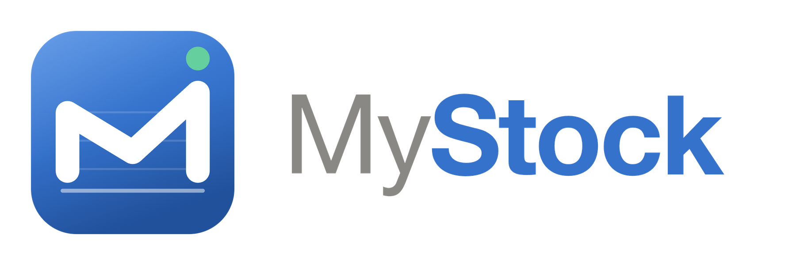

<p align="center">
  
</p>

# MyStock

여러 증권사에 흩어진 계좌의 보유 종목, 매입가, 손익, 비중, 배당금을 한 화면에서 보는 데스크톱 앱입니다
(macOS · Windows · Linux). 서버 없이 모든 데이터를 내 컴퓨터에만 저장합니다.

| 증권사 | 연동 방식 |
|---|---|
| **토스증권** | Open API — 계좌·보유 종목·매매내역 실시간 조회, **배당 자동 동기화** |
| **한국투자증권(KIS)** | Open API — 국내·미국 주식 보유 종목·매매내역 실시간 조회, **국내 배당 자동 동기화** |
| **NH투자증권(나무)** | Open API — 여러 계좌(모의투자 포함) 국내·미국 주식 보유 종목·매매내역 실시간 조회, **배당 자동 동기화** (실데이터 검증 전) |
| **키움증권** | REST API — 앱키에 묶인 계좌 하나의 국내·미국 주식 보유 종목·매매내역 실시간 조회, **배당 자동 동기화** (⚠ **실제 키로 연동 확인 전**) |
| **KB증권** | Open API로 연동한 계좌 하나만 보유 종목·매매내역 자동 동기화, 나머지 계좌와 배당은 CSV·직접 입력 |
| **삼성증권 · 미래에셋증권** | API 연동 없음 — CSV로 보유 종목·매매내역 관리, 배당은 직접 입력 |

## 다운로드와 사용법

- **설치 파일**: [GitHub Releases](https://github.com/ultracat/MyStockInfo/releases)에서 OS에 맞는 파일을 받습니다.
  - macOS(Apple 칩, macOS 13 이상) `.dmg`, Windows `.exe`(64비트), Linux `.AppImage`(x86_64)
  - 릴리스마다 `SHA256SUMS.txt`가 함께 올라갑니다 — 받은 파일이 진짜인지 확인하는 방법은
    [매뉴얼의 "받은 파일 확인하기"](doc/user-manual.md#받은-파일-확인하기-선택)를 보세요.
- **사용자 매뉴얼**: [`doc/user-manual.md`](doc/user-manual.md) — 화면별 사용법, API 키 발급 안내(증권사·Google·한국수출입은행), 백업/복원, 문제 해결.
- **변경 내역**: [`CHANGELOG.md`](CHANGELOG.md) — 버전별 새 기능과 수정(최신 v1.3.1). 새 버전으로 바꿔 설치해도 데이터와 API 키는 그대로 남습니다
  ([매뉴얼의 "새 버전으로 업데이트"](doc/user-manual.md#새-버전으로-업데이트)).
- ⚠ 설치 파일은 **OS별 코드 서명 인증서로 서명되어 있지 않아** 처음 실행할 때 macOS·Windows가 막습니다.
  OS별 허용 방법(macOS 15부터는 우클릭 → 열기가 통하지 않음)은
  [매뉴얼의 "서명하지 않은 앱 처음 실행하기"](doc/user-manual.md#서명하지-않은-앱-처음-실행하기)를 보세요.

## 주요 기능

- **대시보드** — 모든 증권사·계좌를 합친 매입/평가금액, 손익(배당 제외·포함), 보유·섹터 비중, 월별 배당, 월별 수익률(코스피·코스닥 비교), 순자산 추이.
- **보유 종목** — 증권사·계좌별 손익·비중, 배당 포함 손익, 입금 기준 투자원금(토스·NH·키움), 매수 유의사항·장 상태.
- **종목별 수익** — 여러 계좌의 같은 종목을 합쳐 투자금·평가금·누적배당·총 수익률을 한 줄로.
- **배당금** — 월별·증권사별 배당과 수익률(세후 기준), API 증권사는 자동 동기화, 다가오는 배당(한국투자증권 키 필요).
- **매매내역 · 실현손익** — 월별 매수/매도, 이동평균법 실현손익과 해외주식 양도세 참고용 추정치, 증권사 공식 실현손익과 대조.
- **관심종목 · 종목 링크** — 현재가와 월별 종가 차트, 국내 종목 재무·투자의견·ETF 구성(한국투자증권 키 필요).
- **설정** — API 키(OS 키체인 암호화), 환율 인증키, 계좌 별칭·세금 유형, 백업/복원(하루 한 번 자동 백업 포함), Google Sheets 연동(실험적).
- **편의** — 화면 유지, 확대/축소, 새 버전 알림, 화면별 오류 격리, 로그 파일(개인정보 가림).

화면별 자세한 사용법은 [사용자 매뉴얼](doc/user-manual.md)을 보세요.

## 증권사별로 알아둘 점

키 발급과 등록 방법은 [매뉴얼 부록](doc/user-manual.md#부록-api-키-발급-안내)에 있습니다.

| 증권사 | 알아둘 점 |
|---|---|
| **토스증권** | WTS의 Open API 설정에 **허용 IP 등록** 필요. 접속 토큰이 계정당 하나라 다른 곳에서 받으면 앱의 토큰이 무효화됩니다(앱이 다시 받음). |
| **한국투자증권** | 계좌 목록 API가 없어 **계좌번호·상품코드를 직접 입력**. 실전투자만, 해외는 미국만. 미국 주식 배당은 직접 기록. |
| **NH투자증권** | 계좌번호 입력 불필요, 모의투자 계좌도 보임(합계에는 제외). 토큰을 받을 때마다 NH가 보안 알림을 보냅니다. ⚠ 실데이터 검증 전 |
| **키움증권** | 앱키가 계좌 하나에 묶임, **허용 IP 등록** 필요. ⚠ 실제 키로 연동 확인 전 — 키를 등록하면 `npm run check:kiwoom`부터. |
| **KB증권** | API로 연동한 계좌 하나만 자동 동기화. IRP·연금저축·예전 종합계좌와 배당은 CSV·직접 입력. |
| **삼성 · 미래에셋** | API 없음 — CSV(또는 Google Sheets)로 관리, 배당은 직접 입력. |

- API로 받는 배당(토스·한국투자·NH·키움)은 직접 고칠 수 없습니다(한국투자증권 달러 배당만 예외).
- 환율을 못 받으면 달러 금액을 억지로 합치지 않고 "환율 미적용"으로 표시합니다.
- **보안**: 키·토큰은 OS 키체인으로 암호화해 내 컴퓨터에만 저장하고, 앱에 미리 넣은 키는 없습니다. 앱 화면은 외부 코드를 받지 않으며(CSP),
  설치본은 실행 파일 변조·원격 디버깅을 막아 둡니다. 자세한 내용은 [매뉴얼 12장](doc/user-manual.md#12-편의-기능과-문제-해결).

---

## 개발자용

```
backend/    Express 서버 — 증권사 API 호출, 자격증명 암호화 저장, 로컬 저장소
frontend/   React + Vite 화면 (pages/ 화면, pages/<화면>/ 카드·훅, calc/ 계산 + test/)
electron/   Electron 메인 프로세스 — backend를 같은 프로세스에서 구동
doc/        사용자 매뉴얼과 스크린샷
```

- 백엔드가 Electron 메인 프로세스 안에서 도는 이유: API 키 암호화(`safeStorage`)가 메인 프로세스에서만 동작해서입니다.
  백엔드는 `127.0.0.1`에서만, 실행마다 다른 API 토큰으로만 받습니다.
- **새 증권사 추가**: `BrokerAdapter`(`backend/src/brokers/types.ts`) 구현 → `registry.ts` 등록 → `credentialFields.ts`에 키 필드 선언.
  CSV로만 지원하려면 `knownBrokers.ts`에 `hasApiIntegration: false` 한 줄.
- 설계 이유·함정·증권사 API 세부(TR 코드 등)는 각 폴더의 `CLAUDE.md`(= `AGENTS.md`)에 있습니다.

### 실행·검사

```bash
npm install
npm run build:backend   # 최초 1회(electron이 backend/dist를 씀)
npm run dev              # frontend(Vite) + electron
npm test                 # 자동 테스트(가짜 서버, 키 불필요)
npm run lint
npm run check:toss       # 실서버 점검(조회만, 저장된 키 사용) — check:kis / check:nh / check:kiwoom
npm run spec:check       # 증권사 공식 명세가 바뀌었는지(쓰는 엔드포인트의 필드 구조만 비교)
```

- 더블클릭 실행: macOS `start-mac.command`, Windows `start-windows.bat`, Linux `./start.sh`.
- 백엔드를 고치면 `npm run build:backend` 후 Electron 재시작, 프론트엔드는 자동 반영.
- push·PR마다 GitHub Actions가 빌드 → 린트 → 테스트를 돌리고, 매주 증권사 공식 명세(토스·NH·키움·한국투자증권 예제)를 점검합니다.
- `check:toss`는 앱의 토큰을 끊으므로 **앱을 닫고** 실행하세요. 점검 결과에 계좌번호·금액은 나오지 않습니다.
- 데이터는 설치본과 dev가 같은 폴더를 씁니다: macOS `~/Library/Application Support/@mystock/electron/data/`,
  Windows `%APPDATA%\@mystock\electron\data\`, Linux `~/.config/@mystock/electron/data/`.

### 빌드·릴리스

- 로컬 빌드: `npm run package:mac` / `package:linux` / `package:win` → `release/`. Apple Silicon 맥에선 Windows·Linux를 못 만들어 정식 배포는 GitHub Actions로 합니다.
- 릴리스: `version.json` 버전 올리기 + `CHANGELOG.md` 새 절 → main push → `npm run release:tag` → `npm run release:build`(초안 릴리스) →
  확인 후 `gh release edit vX.Y.Z --draft=false --latest`. 자세한 절차는 `electron/CLAUDE.md`.
- 빌드에 넣는 비밀값은 없습니다(외부 서비스 키는 사용자가 설정에서 입력).
- 로고 원본은 `build/icon.svg` 하나 — `npm run generate:icons`로 OS별 아이콘을 만듭니다.
  (흰 **M**은 My Stock이자 오르내리는 주가 선, 초록 점은 정보를 뜻하는 **i**.)

### 다음 단계 (미구현)

- 키움 실키 연동 확인, NH·KIS 해외 실데이터 검증, KIS 모의투자
- 코드 서명/공증, Intel Mac용 설치 파일
- 백엔드 dev 모드 파일 변경 시 Electron 자동 재시작

## 라이선스

MyStock은 **이중 라이선스**로 배포됩니다.

- **AGPL-3.0 (오픈소스)** — [`LICENSE`](LICENSE) 조건을 지키면 누구나 사용·수정·배포할 수 있습니다.
  수정한 버전을 배포하거나 **네트워크 서비스로 다른 사람이 쓰게 하면, 그 전체 소스를 같은 AGPL-3.0으로 공개**해야 합니다.
- **상업 라이선스** — 소스를 공개하지 않고 제품·서비스에 포함하는 등 AGPL-3.0 조건을 따를 수 없는 상업적 이용은
  저작권자의 허락(별도 상업 라이선스)이 필요합니다. 이메일 [ultracat.lcw@gmail.com](mailto:ultracat.lcw@gmail.com)으로 문의해 주세요.

기여는 fork → Pull Request로 받으며, 기여 코드도 두 라이선스로 배포할 수 있도록
[기여자 라이선스 동의서(CLA)](CLA.md)에 동의해 주셔야 합니다 — [CONTRIBUTING.md](CONTRIBUTING.md) 참고.

Copyright © 2026 ChangWoo Lee
