# MyStock 사용자 매뉴얼

MyStock은 여러 증권사 계좌의 보유 종목, 손익, 배당금, 매매내역을 한 화면에 모아 보는 데스크톱 앱입니다.

> 이 매뉴얼의 스크린샷은 실제 화면을 찍은 것이지만, **금액·종목명·종목코드·계좌번호·이메일은
> 모두 가짜 문자로 바꾼 뒤 흐리게 처리**했습니다. 화면 구성과 버튼 위치를 보는 용도로만 참고하세요.
>
> 이 매뉴얼은 **v1.3.3** 기준입니다. 버전별 변경 사항은 [변경 내역(CHANGELOG.md)](../CHANGELOG.md)을 보세요.

## 목차

1. [시작하기](#1-시작하기)
2. [증권사 연결하기 (설정)](#2-증권사-연결하기-설정)
3. [대시보드](#3-대시보드)
4. [보유 종목](#4-보유-종목)
5. [종목별 수익](#5-종목별-수익)
6. [배당금](#6-배당금)
7. [매매내역](#7-매매내역)
8. [실현손익](#8-실현손익)
9. [분석](#9-분석)
10. [리밸런싱](#10-리밸런싱)
11. [보고서](#11-보고서)
12. [관심종목](#12-관심종목)
13. [종목 링크](#13-종목-링크)
14. [데이터 백업·복원과 Google Sheets](#14-데이터-백업복원과-google-sheets)
15. [편의 기능과 문제 해결](#15-편의-기능과-문제-해결)
- [부록. API 키 발급 안내](#부록-api-키-발급-안내)
  - [증권사 API 키](#증권사-api-키)
  - [Google API 키(OAuth 클라이언트) 설정하기](#google-api-키oauth-클라이언트-설정하기) — Google Sheets 연동용
  - [한국수출입은행 환율 인증키](#한국수출입은행-환율-인증키) — 달러 배당 환율용

---

## 1. 시작하기

### 설치본으로 실행
GitHub 릴리스에서 OS에 맞는 파일을 받아 설치합니다.

| OS | 파일 | 지원 환경 |
|---|---|---|
| macOS | `MyStock-<버전>-arm64.dmg` | Apple 칩(M1 이후) Mac, **macOS 13(Ventura) 이상**. Intel Mac용 설치본은 없습니다. |
| Windows | `MyStock.Setup.<버전>.exe` | 64비트 Windows. 지금 사용자 계정에만 설치됩니다. |
| Linux | `MyStock-<버전>.AppImage` | 64비트(x86_64) 배포판 |

> ⚠ **MyStock 설치본은 OS별 코드 서명 인증서로 서명되어 있지 않습니다.** 그래서 처음 실행할 때 macOS·Windows가
> 앱을 막는 것은 정상 동작입니다. 아래 [서명하지 않은 앱 처음 실행하기](#서명하지-않은-앱-처음-실행하기)를 따라 한 번만 허용해 주세요.
> 단, **이 저장소의 GitHub 릴리스에서 직접 받은 파일일 때만** 허용하세요. 다른 곳에서 받은 같은 이름의 파일은 실행하지 마세요.

### 받은 파일 확인하기 (선택)

릴리스에는 설치 파일과 함께 `SHA256SUMS.txt`가 올라갑니다. 받은 설치 파일의 SHA-256 값이 이 파일에 적힌 값과 같으면
GitHub 릴리스에 올라간 그 파일이 맞습니다(받는 도중 바뀌거나 다른 곳의 파일이 아님). 서명이 없는 지금은 이것이 파일이 진짜인지
확인하는 방법입니다.

| OS | 터미널에서 실행 |
|---|---|
| macOS | `shasum -a 256 ~/Downloads/MyStock-<버전>-arm64.dmg` |
| Windows (PowerShell) | `Get-FileHash $HOME\Downloads\MyStock.Setup.<버전>.exe -Algorithm SHA256` |
| Linux | `sha256sum MyStock-<버전>.AppImage` (같은 폴더에 `SHA256SUMS.txt`가 있으면 `sha256sum -c --ignore-missing SHA256SUMS.txt`) |

나온 값을 `SHA256SUMS.txt`의 같은 파일 줄과 비교합니다(대소문자는 상관없습니다). 다르면 설치하지 말고 다시 받으세요.

### 서명하지 않은 앱 처음 실행하기

배포하는 앱은 보통 Apple Developer ID 인증서로 서명하고 Apple 공증(notarization)을 받거나, Windows 코드 서명
인증서로 서명합니다. MyStock은 개인 프로젝트라 이 인증서들이 없습니다. macOS용은 인증서 없는 로컬 서명(ad-hoc)만 되어 있어
"손상된 앱"으로 막히지는 않지만, "확인되지 않은 개발자"의 앱으로 처음 한 번은 막힙니다.
아래 안내는 2026년 11월 기준입니다. OS가 업데이트되면 버튼 이름이나 위치가 바뀔 수 있으니, 다르면 각 절의 공식 안내를 확인하세요.

#### macOS

1. `.dmg`를 열고 **MyStock**을 **응용 프로그램(Applications)** 폴더로 끌어다 놓습니다.
2. 응용 프로그램 폴더에서 MyStock을 엽니다. "'MyStock'을(를) 열지 않음" 창이 뜨면 **완료**를 누릅니다.
   **휴지통으로 이동**은 누르지 마세요.
3. **시스템 설정 → 개인정보 보호 및 보안**으로 가서 아래쪽 **보안** 항목을 봅니다.
   "Mac을 보호하기 위해 'MyStock'을(를) 차단했습니다."라는 문구 옆의 **그래도 열기**를 누릅니다.
   - 이 버튼은 앱을 열려고 시도한 뒤 **약 1시간 동안만** 보입니다. 안 보이면 2단계부터 다시 하세요.
4. 다시 뜨는 창에서 **열기**를 누르고, Mac 암호나 Touch ID로 확인합니다. 이후에는 평소처럼 열립니다.

- **macOS 15(Sequoia) 이후**: 예전 방식인 Finder에서 Control-클릭(우클릭) → **열기**로는 더 이상 열리지 않습니다. 위 순서를 따르세요.
  macOS 14 이하는 Control-클릭 → 열기도 됩니다.
- **"'MyStock'은(는) 손상되었기 때문에 열 수 없습니다"** 가 뜨면, 내려받을 때 붙은 격리 표시를 지웁니다.
  터미널에서 다음을 실행한 뒤 다시 엽니다.

  ```bash
  xattr -dr com.apple.quarantine "/Applications/MyStock.app"
  ```
- **키체인 접근 허용 창**: API 키를 저장하거나 앱이 저장된 키를 처음 읽을 때, macOS가 키체인 접근을 허용할지 묻습니다.
  **항상 허용**을 누르세요. 앱을 새 버전으로 바꾸면 이 창이 다시 뜰 수 있습니다. 서명이 버전마다 달라지기 때문입니다.
  여기서 **거부**하면 저장된 키를 읽지 못해 증권사 조회가 실패합니다. 그때는 **설정 → API 키 등록**에서 키를 다시 저장하세요.
- 공식 안내: [알 수 없는 개발자의 Mac 앱 열기](https://support.apple.com/ko-kr/guide/mac-help/mh40616/mac),
  [Mac에서 앱 안전하게 열기](https://support.apple.com/ko-kr/102445)

#### Windows

1. `MyStock.Setup.<버전>.exe`를 실행합니다. **"Windows의 PC 보호"**(Microsoft Defender SmartScreen) 창이 뜨면
   **추가 정보**를 누르고, 파일 이름이 `MyStock.Setup.<버전>.exe`인지 확인한 뒤 **실행**을 누릅니다.
2. 설치는 확인 화면 없이 바로 진행되고, 지금 로그인한 사용자 계정에만 설치됩니다(관리자 권한 불필요). 끝나면 MyStock이 실행됩니다.

- **추가 정보** 버튼이 없거나 실행이 계속 막히면, 받은 파일을 우클릭 → **속성** → 아래쪽 **차단 해제**에 체크한 뒤
  **확인**을 누르고 다시 실행합니다. PowerShell에서는 다음과 같습니다.

  ```powershell
  Unblock-File -Path "$env:USERPROFILE\Downloads\MyStock.Setup.<버전>.exe"
  ```
- **스마트 앱 컨트롤, 회사 보안 정책(AppLocker, Microsoft Defender for Endpoint), 백신 프로그램**이 막는 경우에는
  허용 버튼이 없습니다. 회사 PC라면 IT 담당자에게 예외를 요청하세요. 스마트 앱 컨트롤은 직접 끄지 않는 것을 권합니다.
  최근 Windows는 다시 켤 수 있지만, 예전 버전은 끄면 PC를 초기화해야 다시 켤 수 있습니다.
- 공식 안내: [Windows Defender SmartScreen 개요](https://learn.microsoft.com/ko-kr/windows/security/operating-system-security/virus-and-threat-protection/microsoft-defender-smartscreen/),
  [스마트 앱 컨트롤 자주 묻는 질문](https://support.microsoft.com/ko-kr/topic/285ea03d-fa88-4d56-882e-6698afdb7003)

#### Linux

1. 실행 권한을 주고 실행합니다.

   ```bash
   chmod +x MyStock-<버전>.AppImage
   ./MyStock-<버전>.AppImage
   ```

- **FUSE 관련 오류**("dlopen(): error loading libfuse.so.2" 등)가 나면 FUSE 2 라이브러리를 설치합니다.
  Ubuntu 22.04는 `sudo apt install libfuse2`, Ubuntu 24.04 이후는 `sudo apt install libfuse2t64`입니다.
  설치할 수 없으면 `./MyStock-<버전>.AppImage --appimage-extract-and-run`으로 실행합니다.
- **Ubuntu 24.04 이후 샌드박스 오류**("The SUID sandbox helper binary was found, but is not configured correctly" 등)는
  배포판의 AppArmor 정책 때문입니다. 관리자에게 AppArmor 프로필 추가를 요청하세요.
  `--no-sandbox` 옵션으로도 실행은 되지만 보안 격리가 꺼지므로 잠깐 시험할 때만 쓰세요.
- **키링이 없는 환경**(GNOME 키링·KWallet 미설치)에서는 API 키를 안전하게 암호화할 수 없어서,
  MyStock은 키를 평문으로 저장하지 않고 **저장 자체를 거부**합니다. 이때 **설정 → API 키 등록** 위에 빨간 안내가 뜹니다.
  `gnome-keyring`이나 KWallet을 설치·실행한 뒤 앱을 다시 켜고 키를 저장하세요. CSV로만 관리하는 증권사는 키가 필요 없어 그대로 쓸 수 있습니다.
- 공식 안내: [AppImage — FUSE 관련 오류](https://docs.appimage.org/user-guide/troubleshooting/fuse.html)

### 새 버전으로 업데이트
앱에는 자동 설치가 없습니다. 새 버전이 나오면 사이드바 아래에 **새 버전 알림**이 뜨고([앱 정보](#앱-정보)에서 끌 수 있음),
[GitHub 릴리스](https://github.com/ultracat/MyStockInfo/releases)에서 설치 파일을 받아 직접 바꿔 설치합니다. 무엇이 바뀌었는지는 릴리스 본문이나 저장소의
[변경 내역(CHANGELOG.md)](../CHANGELOG.md)에서 볼 수 있습니다. 지금 쓰는 버전은 사이드바의 **정보**에서 확인합니다.

1. MyStock을 완전히 종료합니다. macOS는 `⌘Q`, Windows·Linux는 창을 닫습니다.
2. OS별로 새 파일을 설치합니다.
   - **macOS**: `.dmg`를 열어 `MyStock`을 응용 프로그램 폴더로 끌어 놓고, 기존 앱을 **대치**합니다.
   - **Windows**: 새 `MyStock.Setup.<버전>.exe`를 실행합니다. 기존 설치 위에 덮어씁니다.
   - **Linux**: 새 `.AppImage`에 실행 권한(`chmod +x`)을 주고 실행합니다. 예전 파일은 지워도 됩니다.
3. 처음 실행할 때 OS 경고가 다시 뜰 수 있습니다. [서명하지 않은 앱 처음 실행하기](#서명하지-않은-앱-처음-실행하기)와 같은 방법으로 허용하세요.
   macOS는 키체인 접근을 다시 물을 수 있는데, 이때도 **항상 허용**을 누릅니다.

보유 종목·매매내역·배당 기록, 저장한 API 키와 설정은 앱 밖의 사용자 데이터 폴더에 있어서 **업데이트해도 그대로 남습니다.**
그래도 불안하면 업데이트 전에 **설정 → 데이터 백업/복원**에서 백업 파일을 받아 두세요.

**v1.2.2 이하에서 올릴 때 알아둘 것**
- **macOS 13(Ventura) 이상**이 필요합니다. 그보다 낮으면 먼저 시스템 설정 → 일반 → 소프트웨어 업데이트로 macOS를 올리세요.
- 달러 배당의 지급월 평균 환율과 Google Sheets 연동은 이제 **본인이 발급받은 키를 설정에 넣어야** 동작합니다(예전 설치본에서는
  이 두 기능이 꺼져 있었습니다). 필요하면 [부록. API 키 발급 안내](#부록-api-키-발급-안내)를 따라 넣으세요. 증권사 API 키는 다시 넣을 필요가 없습니다.

### 소스에서 실행
저장소 루트의 실행 파일을 쓰면 첫 실행 때 필요한 설치까지 자동으로 합니다.

| OS | 방법 |
|---|---|
| macOS | Finder에서 `start-mac.command` 더블클릭 (또는 터미널에서 `./start.sh`) |
| Linux | 터미널에서 `./start.sh` |
| Windows | `start-windows.bat` 더블클릭 |

- 앱은 한 번에 하나만 뜹니다. 이미 실행 중이면 새로 띄우지 않고 기존 창을 앞으로 가져옵니다.
- 기본 포트(4317, 5173)를 다른 프로그램이 쓰고 있어도 자동으로 빈 포트로 옮겨 실행됩니다.

### 지원 증권사

| 증권사 | 연동 방식 | 할 수 있는 것 |
|---|---|---|
| 토스증권 | Open API | 계좌·보유 종목·매매내역 실시간 조회, 배당 자동 동기화(국내 ETF 분배금·외화세금환급 포함) |
| 한국투자증권(KIS) | Open API | 국내·미국 주식 보유 종목·매매내역 실시간 조회, 국내 배당 자동 동기화 |
| 키움증권 | REST API | 앱키에 묶인 계좌 하나의 국내·미국 주식 보유 종목·매매내역 실시간 조회, 국내·미국 배당 자동 동기화 — ⚠ **실제 키움 계좌로 연동 확인 전** |
| LS증권 | REST API | 앱키에 묶인 계좌 하나의 국내·미국 주식 보유 종목·매매내역 실시간 조회, 국내 배당 자동 동기화 — ⚠ **실제 LS증권 계좌로 연동 확인 전** |
| DB증권 | REST API | 앱키에 묶인 계좌 하나의 국내·미국 주식 보유 종목·매매내역 실시간 조회, 국내·미국 배당 자동 동기화 — ⚠ **실제 DB증권 계좌로 연동 확인 전** |
| NH투자증권(나무) | Open API | 앱키에 연결된 모든 계좌(모의투자 포함)의 국내·미국 주식 보유 종목·매매내역 실시간 조회, 국내·미국 배당 자동 동기화 — **실제 거래 데이터로는 아직 검증 전** |
| KB증권 | Open API(계좌 1개) + CSV | API를 등록한 계좌 하나의 보유 종목·매매내역은 화면을 열 때 자동 동기화, 나머지 계좌는 CSV, 배당은 직접 입력 |
| 삼성증권 · 미래에셋증권 | CSV 전용 | 보유 종목·매매내역을 CSV로 가져와 관리, 배당은 직접 입력 |

배당금은 **토스증권·한국투자증권·NH투자증권·키움증권·LS증권·DB증권은 API로 자동 동기화**하고(한국투자증권·LS증권의 미국 주식 배당은 제외), 그 밖의 증권사는 **직접 기록**합니다([6. 배당금](#6-배당금)).

---

## 2. 증권사 연결하기 (설정)

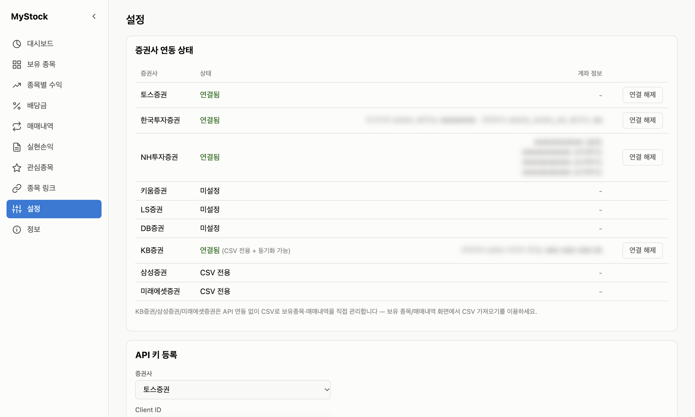

사이드바의 **설정**에서 합니다.

1. **증권사 연동 상태** 표에서 증권사별 연결 여부를 확인합니다. CSV 전용 증권사는 "CSV 전용"으로 보입니다.
2. **API 키 등록**에서 증권사를 고르면 그 증권사에 필요한 입력칸이 자동으로 나타납니다.

   | 증권사 | 입력할 값 |
   |---|---|
   | 토스증권 | Client ID, Client Secret |
   | 한국투자증권 | 앱키, 앱시크릿, 계좌번호(8자리), 상품코드(2자리) |
   | NH투자증권 | 앱키, 앱시크릿 (계좌번호는 계좌 목록 API로 자동으로 찾음) |
   | 키움증권 | 앱키, 시크릿키 (계좌번호는 API가 알려 줌 — 키 하나에 계좌 하나) |
   | LS증권 | 앱키, 시크릿키 (계좌번호는 API가 알려 줌 — 키 하나에 계좌 하나) |
   | DB증권 | 앱키, 시크릿, 그 키를 받은 계좌번호 (API가 계좌번호를 알려주지 않아 화면 표시용으로 적음 — 키 하나에 계좌 하나) |
   | KB증권 | appKey, appSecret, API를 연동한 계좌번호 |

3. **저장**을 누르면 끝입니다. 키는 OS 키체인 기반 암호화로 이 컴퓨터에만 저장되고 외부로 보내지 않습니다.
   - NH투자증권은 저장하면 **증권사 연동 상태**의 계좌 정보 칸에 찾은 계좌가 구분과 함께 보입니다(일반·주문대리인·**모의투자**).
   - 키움증권은 키움 포털에 **MyStock을 실행하는 PC의 IP를 등록**해야 조회됩니다. 인터넷 IP가 바뀌면 다시 등록하세요.
     ⚠ 키움 연동은 아직 실제 키움 계좌로 확인하지 못했습니다. 숫자가 키움 앱과 다르면 알려 주세요.
   - LS증권·DB증권도 키 하나가 계좌 하나에 묶입니다(DB증권은 계좌마다 키를 따로 받고 1년마다 다시 받습니다).
     ⚠ 두 증권사 연동은 아직 실제 계좌로 확인하지 못했습니다. 숫자가 증권사 앱과 다르면 알려 주세요.
   - NH투자증권은 접근 토큰을 새로 받을 때마다 NH가 **보안 알림**을 보냅니다. 앱은 토큰을 24시간 저장해 재사용하므로 하루 한 번 정도만 옵니다.

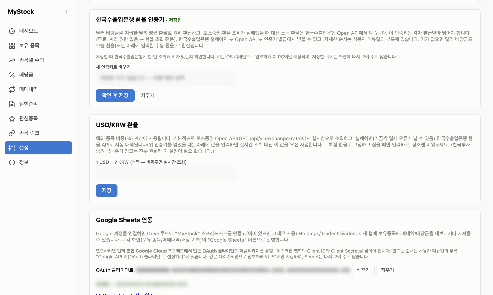

같은 화면 아래쪽에서 다음도 설정합니다.

- **한국수출입은행 환율 인증키**(달러 배당을 쓴다면 필수): 달러 배당금을 **받은 달의 평균 환율**로 환산하고, 토스증권 환율을 못 받을 때
  대신 쓰는 환율을 한국수출입은행에서 받습니다. 인증키는 **각자 발급**받아 넣습니다(무료, 환율 조회 전용 — 계좌 권한 없음).
  발급 방법은 [부록의 "한국수출입은행 환율 인증키"](#한국수출입은행-환율-인증키)를 보세요.
  1. 발급받은 키를 붙여 넣고 **확인 후 저장**을 누릅니다. 앱이 한국수출입은행에 한 번 조회해 키가 맞는지 확인한 뒤 저장합니다.
  2. 제목 옆이 **저장됨**으로 바뀌면 끝입니다. 키는 이 PC의 OS 키체인으로 암호화해 저장되고, 다시 화면에 보이지 않습니다.
  - 키가 없으면 제목 옆에 **입력 필요**가 보이고, 배당금 화면 위에도 안내가 뜹니다. 이때 달러 배당은 오늘 환율(또는 아래 수동 환율)로 환산됩니다.
  - "오늘 호출 한도가 다 찼다"는 안내가 뜨면 키는 저장된 것이고 다음 날부터 조회됩니다.
- **USD/KRW 환율**: 실시간 환율을 못 가져올 때 쓸 환율을 직접 입력합니다. 입력하면 실시간 환율보다 우선합니다.
- **Google Sheets 연동**(실험적 기능): 먼저 본인 Google OAuth 클라이언트(Client ID/Secret)를 넣고 **클라이언트 저장** → **Google 계정 연결**. [11장](#google-sheets-연동)과 [부록](#google-api-키oauth-클라이언트-설정하기) 참고.
- **계좌 별칭 · 세금 유형**: 계좌마다 알아보기 쉬운 이름(별칭)과 표시용 계좌번호, 세금 유형(일반/ISA/연금저축/IRP)을 정합니다.
  - 별칭은 모든 화면의 계좌 선택 목록에 쓰입니다.
  - 세금 유형은 [실현손익](#8-실현손익) 계산에 쓰입니다(ISA·연금 계좌는 해외주식 양도세 계산에서 빠짐).
  - **배당에도 쓰입니다.** ISA·연금저축·IRP 계좌는 받은 배당에서 세금을 바로 떼지 않아, 이 유형으로 정해 둔 계좌의 API 배당은 **세금 0원·받은 금액 그대로** 기록됩니다(증권사 API가 계산상 세금을 알려 줘도 실제로는 떼지 않으므로). 유형을 바꾼 뒤 배당금 화면을 열면 다시 맞춰집니다.
  - 토스증권은 계좌번호가 화면에 "1"처럼 보이므로, 여기서 실제 계좌번호를 표시용으로 입력해 두면 편합니다.
  - NH투자증권 모의투자 계좌는 "(모의투자)"로 표시되고 세금 유형은 "해당 없음"입니다(실현손익 계산에 들어가지 않음). 별칭은 붙일 수 있습니다.

---

## 3. 대시보드

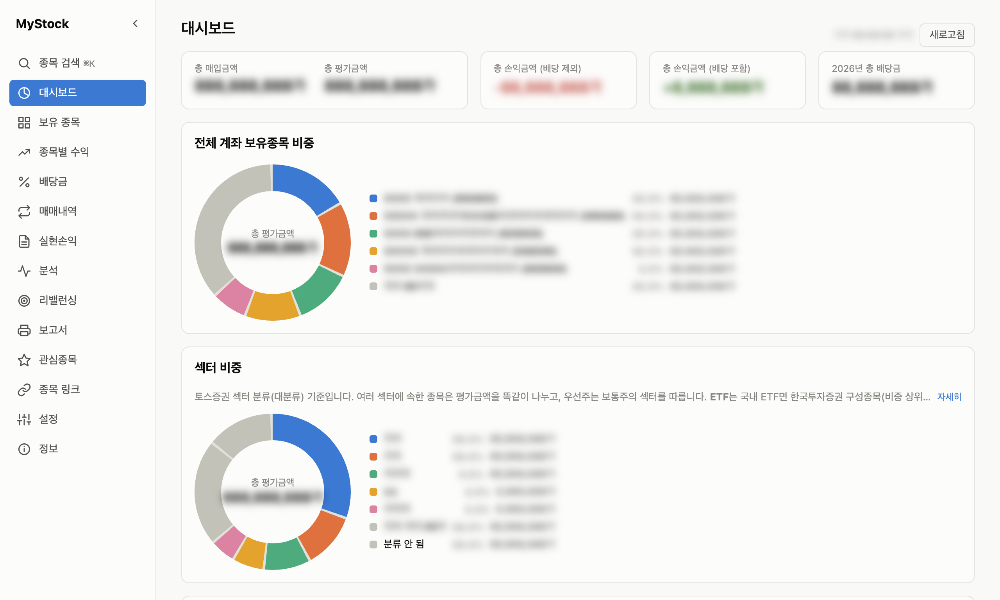

앱을 켜면 처음 보이는 화면으로, **모든 증권사·모든 계좌를 합친** 요약입니다.

- **상단 카드**
  - **총 매입금액 / 총 평가금액**: 한 카드에 나란히 보입니다.
  - **총 손익금액 (배당 제외)**: 평가금액 − 매입금액.
  - **총 손익금액 (배당 포함)**: 위 값에, 지금 보유 중인 종목이 **그 계좌에서** 받은 배당금을 더한 값입니다. 다 팔아버린 종목의 배당은 들어가지 않습니다.
  - **N년 총 배당금**: 아래 **월별 배당금** 카드에서 고른 연도(기본은 올해)의 배당 합계입니다.
- **전체 계좌 보유종목 비중**: 평가금액 상위 종목과 나머지("기타")를 도넛으로 보여줍니다. 도넛 **가운데 숫자**(총 평가금액)를 누르면 종목별/계좌별 상세가 열립니다.
  배당금 비중 도넛과 월별 배당금 막대도 같은 방식으로 누르면 상세가 열립니다.
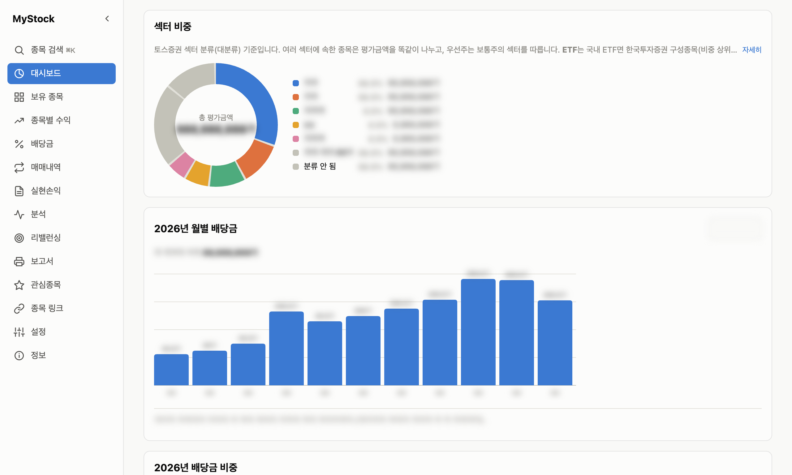

- **섹터 비중**: 보유 종목을 토스증권 섹터 분류(대분류: 반도체, 자동차, 금융 등)로 묶은 도넛입니다(토스 API 키 필요).
  - 여러 섹터에 속한 종목은 평가금액을 똑같이 나누고, **우선주는 보통주의 섹터**를 따릅니다.
  - **ETF도 섹터로 나눕니다.**
    - **국내 ETF**(한국투자증권 API 키 필요)는 구성종목 비중대로 쪼갭니다. 예를 들어 코스피200 ETF라면 반도체 몇 %, 금융 몇 %로 나뉩니다.
      한국투자증권은 비중 상위 30개 종목만 알려 주므로 나머지 비중은 "분류 안 됨"입니다.
    - 구성종목으로 못 나누는 ETF(미국 ETF, 미국 자산을 담은 국내 ETF 등)는 **토스증권이 분류한 섹터**(예: 반도체 ETF → 반도체)에 넣습니다.
    - 어디에도 분류되지 않은 ETF(미국 지수·커버드콜 ETF 등)와 채권·현금 비중은 회색 **"분류 안 됨"** 조각입니다.
  - 분류표는 하루에 한 번 새로 받습니다. 그날 처음 열 때 종목 섹터는 수십 초, **ETF 섹터 분류는 약 2분** 걸리며, 다 받으면 도넛이 저절로 다시 그려집니다.

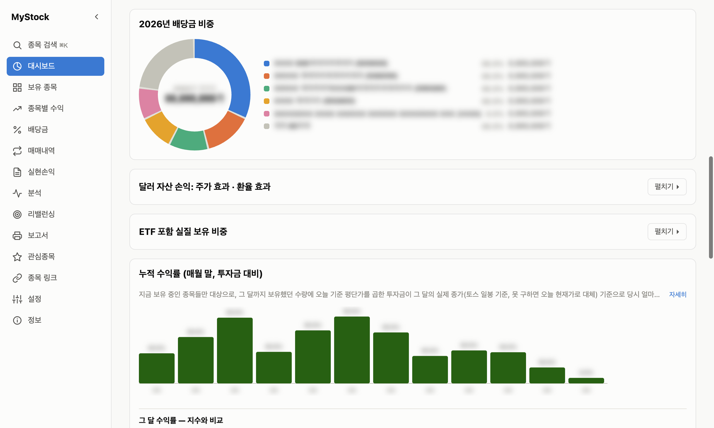

아래로 내리면 연도별 **월별 배당금**, **배당금 비중**, **매월 투자금 대비 수익률**, **월별 총 투자금·총 수입금(평가금액)**, **순자산 추이** 차트가 이어집니다.

- **달러 자산 손익: 주가 효과 · 환율 효과** (접힌 카드, 펼치면 계산): 미국 주식의 원화 손익을 **주가 효과**(지금가 − 평단가를 지금 환율로)와
  **환율 효과**(달러 원금 × (지금 환율 − 매입 환율))로 나눕니다. 매입 환율은 매매내역의 매수 달 평균 환율로 계산해서, 매매내역이 다 없는 종목은 빠집니다.
- **ETF 포함 실질 보유 비중** (한국투자증권 API 키 필요, 접힌 카드): 보유한 국내 ETF를 구성 종목(비중 상위 30개)으로 펼쳐 직접 보유한 같은 종목과 합칩니다.
  예를 들어 삼성전자를 직접 5%, 여러 ETF를 통해 7% 갖고 있으면 실제로는 12%라는 것을 보여 줍니다. 미국 ETF는 구성 정보가 없어 한 종목으로 봅니다.
- **지수와 비교**: "매월 보유종목 투자금 대비 수익률" 카드 아래 표에서 달마다 내 보유종목 수익률과 **코스피·코스닥** 수익률을 나란히 봅니다(토스 API 키 필요).
  내 보유종목 수익률은 그 달 새로 넣은 투자금을 빼고 계산한 근사치입니다. 토스 API가 미국 지수를 제공하지 않아 국내 지수만 비교합니다.

- 달러 배당금은 배당을 받은 **그 달의 평균 환율**로 원화 환산합니다([한국수출입은행 환율 인증키](#한국수출입은행-환율-인증키)가 있을 때 — 없으면 오늘 환율).
- 이 화면은 켜 둔 채로는 자동으로 새로고침하지 않습니다. 오른쪽 위 **새로고침**을 누르세요. 다른 메뉴에 갔다가 30초 넘게 지나 돌아오면
  보이는 내용은 그대로 둔 채 뒤에서 새로 받습니다([메뉴를 옮겨도 화면이 그대로 남습니다](#메뉴를-옮겨도-화면이-그대로-남습니다)).

---

## 4. 보유 종목

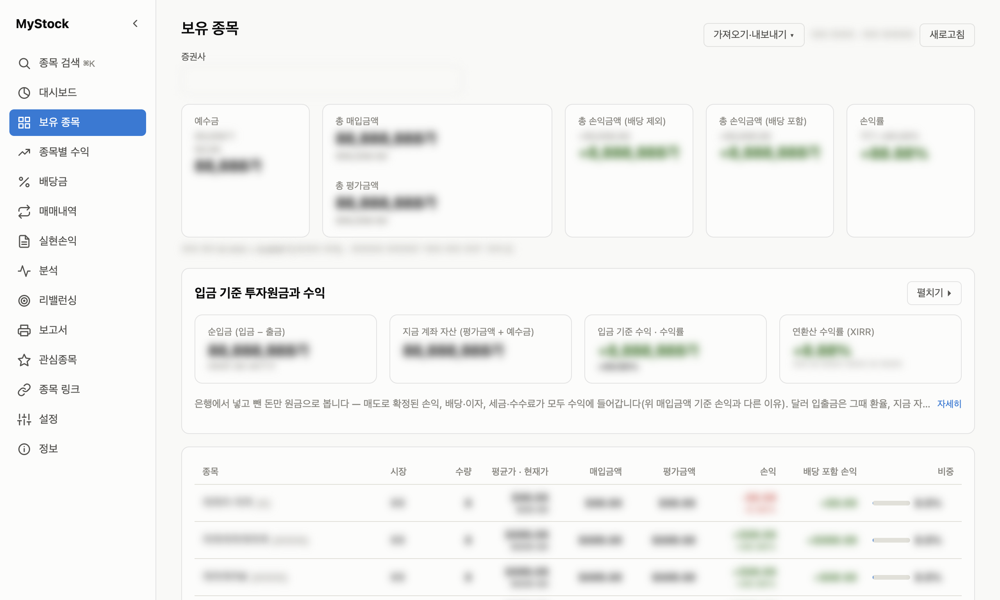

증권사와 계좌를 하나 골라 그 계좌의 보유 종목을 자세히 봅니다.

1. **증권사**를 고르고, **계좌**를 고릅니다. 계좌 목록 맨 아래 **전체 계좌**를 고르면 그 증권사의 모든 계좌를 합쳐서 보고, 표에 "계좌" 열이 생깁니다.
2. 상단 카드: 예수금, 총 매입금액/총 평가금액, **총 손익금액(배당 제외/포함)**, 손익률. 달러 보유분이 있으면 원화·달러·합계(환산)로 나눠 보여줍니다.
   - 한국투자증권·NH투자증권·키움증권은 **국내 주식과 미국 주식**을 함께 보여줍니다(미국 주식은 달러, 달러 예수금 포함). 미국 외 해외 시장은 지원하지 않습니다.
   - **NH투자증권 모의투자 계좌**도 계좌 목록에 "(모의투자)"로 나옵니다. 고르면 가상 자산이라는 안내가 뜨고, 이 화면과 매매내역에서만 보입니다 —
     **전체 계좌**(이름이 "전체 계좌 (모의투자 제외)"로 바뀜)·대시보드·종목별 수익·배당·실현손익 합계와 순자산 기록에는 넣지 않습니다.
3. 종목 표의 열

   | 열 | 뜻 |
   |---|---|
   | 매입평균가 / 현재가 | 종목의 통화(원 또는 USD) 기준 |
   | 매입금액 / 평가금액 / 손익금액 / 손익률 | 증권사가 알려준 값 |
   | **배당 포함 손익금액** | 손익금액 + **이 계좌에서 이 종목으로** 받은 배당금. 다른 계좌의 같은 종목 배당은 섞지 않습니다. 마우스를 올리면 평가손익과 배당금이 나눠 보입니다. |
   | 비중 | 이 계좌(또는 전체 계좌) 안에서의 평가금액 비중 |

- 토스·KIS·NH·키움 계좌는 **1분마다 자동 새로고침**되고, 바로 갱신하려면 **새로고침**(10초에 한 번)을 누릅니다.
  - 화면 위에 **국내·미국 장 상태**(예: "국내 정규장 · 미국 데이마켓", "국내 휴장")가 보입니다. **두 시장이 모두 닫혀 있으면 자동 새로고침을 쉽니다**(시세가 안 움직여서). 수동 새로고침은 언제든 됩니다.
- 종목명 옆 빨간 배지는 **매수 유의사항**입니다: 정리매매, 단기과열, 투자경고, 투자위험, VI 발동, 신주인수권(토스 API 키 필요). 마우스를 올리면 기간이 보입니다.
- KB증권의 API 연동 계좌는 화면을 열 때 백그라운드로 최신화됩니다.
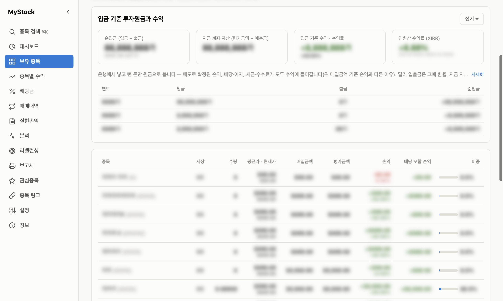

- **입금 기준 투자원금과 수익 (토스증권·NH투자증권·키움증권)**: 표 위 카드에서 은행에서 넣고 뺀 돈(순입금)과 지금 계좌 자산(평가금액 + 예수금)을
  비교한 **실제 수익·수익률**을 봅니다. 매입금액 기준 손익과 달리 매도로 확정된 손익, 배당·이자, 세금·수수료가 모두 들어갑니다.
  펼치면 연도별 입금·출금이 보입니다.
  - **연환산 수익률(XIRR)**: 돈을 넣고 뺀 **시점까지** 반영한 연 수익률입니다. 위 수익률은 시점을 따지지 않아, 최근에 크게 넣었으면 낮게 보이는데 이 값은 그렇지 않습니다.
  - 환전은 계좌 안에서 통화만 바뀌는 것이라 원금에 넣지 않고, ETF 분배금·외화세금환급처럼 종목이 붙은 입금도 넣지 않습니다.
  - **다른 증권사에서 옮겨 온 주식(입고)은 금액이 없어 원금에 들어가지 않습니다** — 입고가 있으면 카드가 건수를 알려 주고, 수익이 그만큼 크게 보일 수 있습니다.
  - NH투자증권은 입출금내역의 입금·출금을 원금으로 셉니다(배당·이자·세금 입출금은 제외, 원화만). 모의투자 계좌에는 이 카드가 없습니다.
  - 한국투자증권은 입출금 내역 API가 없어 이 카드가 없습니다.
- 종목명을 누르면 [종목 링크](#13-종목-링크)에 정한 웹페이지(기본: 토스증권 종목 페이지)가 브라우저로 열립니다.

### CSV로 보유 종목 관리 (삼성·미래에셋·KB 등)
- **CSV 내보내기 (전체)**: 저장된 모든 증권사·계좌의 보유 종목을 한 파일로 받습니다. 이 파일을 고쳐서 그대로 다시 가져올 수 있습니다.
- **CSV 가져오기**: 파일에 나온 계좌마다 **기존 보유 종목을 지우고 파일 내용으로 교체**합니다(덮어쓰기). 같은 파일을 여러 번 가져와도 쌓이지 않습니다.
- 주요 컬럼: `broker, accountId, symbol, quantity, averagePurchasePrice, lastPrice, purchaseAmount, marketValue, profitLossAmount, profitLossRate, commission, tax, currency, market` (+ 선택 `memo`)
  - `memo`는 IRP처럼 같은 종목을 "개인납입/회사납입"으로 나눠 적을 때 씁니다.
  - 종목명은 적지 않아도 종목코드로 자동 조회됩니다.
- API로 실시간 연동되는 계좌의 행은 가져오기에서 건너뜁니다.
- 내보낸 CSV에서 `=`, `+`, `-`, `@`로 시작하는 **글자** 칸(메모 등)은 앞에 `'`가 붙습니다. 엑셀·구글 시트가 그 칸을 수식으로
  실행하지 않게 하려는 것입니다(음수 같은 숫자는 그대로). MyStock으로 다시 가져오면 `'`를 자동으로 뗍니다.
  매매내역·배당금의 CSV 내보내기도 같습니다.

---

## 5. 종목별 수익

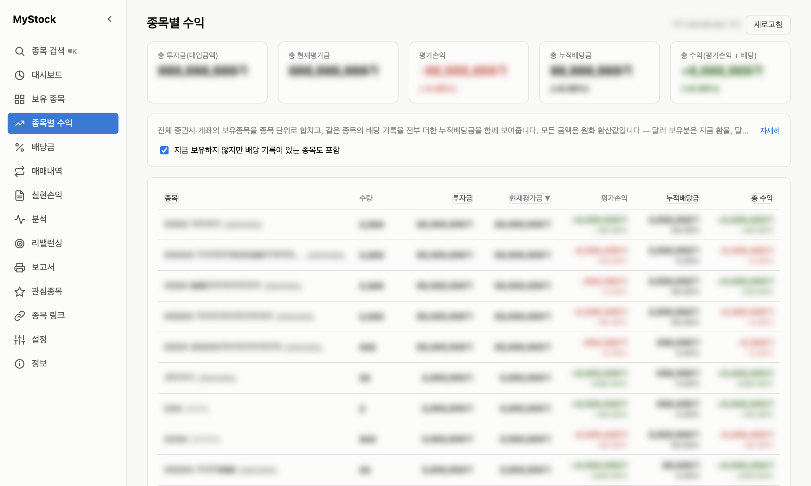

**모든 증권사·계좌를 종목 단위로 합쳐서**, 종목마다 "얼마를 넣었고, 지금 얼마이고, 배당을 얼마나 받았나"를 한 줄로 봅니다.

- 열: 수량, 투자금, 현재평가금, 평가손익, 손익률, 누적배당금, 배당수익률, **총 수익(평가손익 + 배당)**, 총 수익률
- 금액 열 제목을 누르면 그 기준으로 정렬됩니다.
- **지금 보유하지 않지만 배당 기록이 있는 종목도 포함**: 다 팔았지만 배당을 받았던 종목까지 보여줄지 정합니다.
- 보유 종목 화면의 "배당 포함 손익금액"은 계좌별, 이 화면은 **종목 전체** 기준이라는 점이 다릅니다.

---

## 6. 배당금

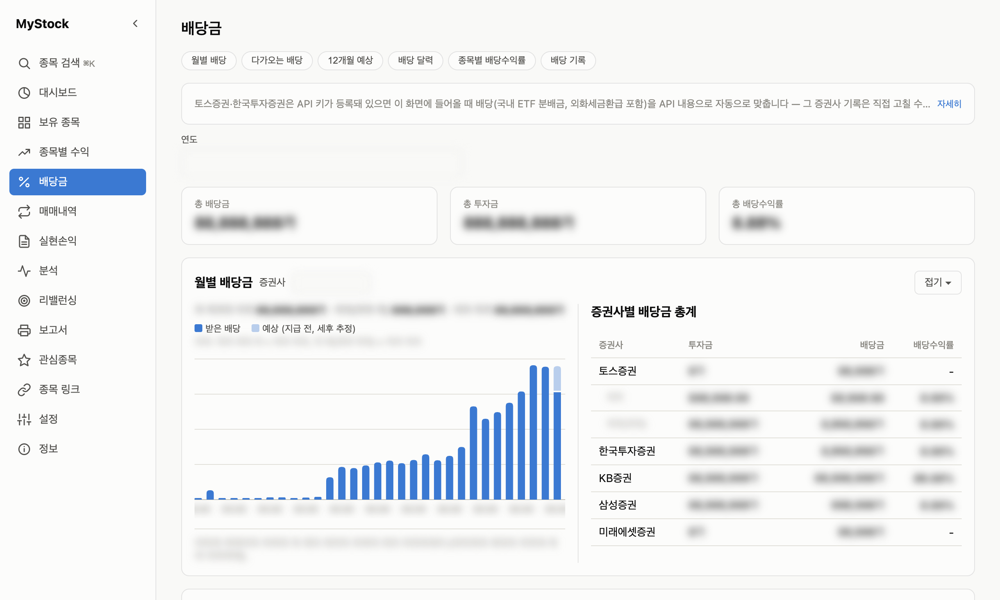

배당금은 **세후 실수령액**으로 기록하고, 원천징수 **세금**은 따로 적습니다(세전 = 배당금 + 세금). 모든 화면의 배당 합계는 세후 기준입니다.

**월별 배당금** 그래프에는 아래 "다가오는 배당"(한국투자증권 API 키 필요)의 아직 지급 전인 배당이 같은 색의 **흐린 막대**로 받은 배당 위에
얹혀 보입니다. 받은 배당과 같은 세후 기준으로 맞추려고, 확정 건은 세금을 빼고 예상·추정 건은 국내 15.4%·미국 15% 원천징수를 가정해 뺀
**추정치**입니다(설정에서 **ISA·연금저축·IRP**로 정해 둔 계좌의 국내 배당은 원천징수가 없어 세전 그대로). 예상이 얹힌 달은 숫자가 둘입니다 — **진한 막대 바로 위가 받은 배당**, **맨 위(흐린 글씨)가 예상 포함 합계**입니다.
막대에 마우스를 올리면 받은 배당·예상·예상 포함 합계를 나눠 보여 줍니다.

- **토스증권·한국투자증권·NH투자증권·키움증권·LS증권·DB증권 (API 자동 동기화)**: API 키를 등록해 두면 이 화면에 들어올 때마다 그 계좌의 배당 기록을
  **API 내용으로 맞춥니다.** 목록 위 **배당 동기화** 버튼으로 바로 다시 맞출 수도 있습니다.
  - 증권사 API가 원천이라 이 증권사들의 배당은 **직접 추가·수정·삭제할 수 없고**(목록에 "API 연동"으로 표시),
    CSV·Google Sheets 가져오기에서도 건너뜁니다. 직접 붙인 메모는 동기화 때 사라집니다.
    단, **한국투자증권·LS증권의 달러 배당**(미국 주식)은 API가 주지 않으므로 직접 기록하고 고칠 수 있습니다(아래).
  - **토스증권**: 일반 배당, **국내 ETF 분배금**, **외화세금환급**(미국 ETF 배당에서 뗀 세금을 이듬해 돌려받은 돈, 메모 "외화세금환급").
    날짜는 토스증권 앱에 보이는 입금일입니다. 미국 배당은 현지 세금이 이미 빠진 금액이라 세금 칸이 0입니다.
  - **한국투자증권**: 국내 배당과 ETF 분배금. 날짜는 현금 지급일이고, **지급 예정인 배당은 지급일이 지나야 들어옵니다.**
    해외(미국 주식) 배당은 계좌 기준으로 조회하는 API가 없어 가져오지 않습니다 — **달러 배당은 직접 기록**합니다(배당 기록 추가에서
    증권사 "한국투자증권 (달러 배당만)"을 고르면 통화가 달러로 고정됩니다). 직접 적은 달러 배당은 동기화가 지우지 않습니다.
  - **NH투자증권**: 국내 배당·ETF 분배금(종합거래내역의 입금)과 **미국 주식 배당(달러, 해외 거래내역의 입금)**을 모두 가져옵니다.
    실전 계좌만 동기화하고 모의투자 계좌는 넣지 않습니다. ⚠ 실제 배당 데이터로는 아직 검증 전이라, 금액이 증권사 앱과 다르면 알려 주세요.
  - **키움증권**: 거래내역의 입금 중 배당·분배금(원화)과 미국 주식 배당(달러)을 가져옵니다. ⚠ 실제 키움 데이터로 확인 전입니다.
  - **LS증권**: 계좌 거래내역의 입금 중 배당·분배금(원화)만 가져옵니다. 미국 주식 배당은 직접 기록합니다. ⚠ 실제 데이터로 확인 전입니다.
  - **DB증권**: 국내 배당·분배금(원화)과, 해외 거래내역의 배당 입금에서 원천세를 뺀 미국 주식 배당(달러)을 가져옵니다. ⚠ 실제 데이터로 확인 전입니다.
  - 우선주 배당은 증권사가 보통주 코드로 알려 주는데, 우선주를 사고판 기록이 있으면 우선주 코드로 저장합니다.
- **KB·삼성·미래에셋**: 입금된 배당을 조회할 수 있는 API가 없어서, 받은 배당을 **직접 기록**합니다(세금은 선택).

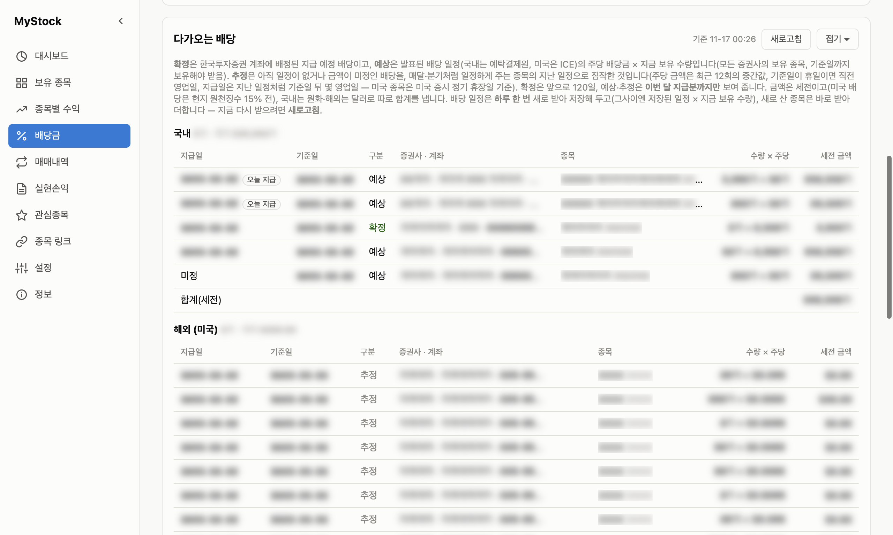

- **다가오는 배당 (한국투자증권 API 키 필요)**: 국내와 미국 배당을 보여줍니다. 확정은 앞으로 120일, 예상·추정은 **이번 달에 지급될 것만** 보여 줍니다.
  지급일 **당일까지 목록에 남고**(그날은 지급일 옆에 **오늘 지급** 표시) **다음 날 빠집니다**(입금이 오후 늦게 되는 날도 있어서). 그 전이라도 **같은 계좌에 같은 종목의 배당이 들어오면**
  (받은 배당 목록에 기록되면, 지급일 앞뒤 3일 안) 다가오는 배당과 그래프의 예상 막대에서 바로 빠집니다.
  한국투자증권 키가 없으면 표 대신 "설정 → API 키 등록에서 한국투자증권 키를 등록해주세요"라는 안내가 뜹니다 — 한국투자증권 계좌가 없어도
  키만 있으면 다른 증권사의 보유 종목까지 보입니다.
  - **확정**: 한국투자증권 계좌에 배정된 지급 예정 배당(세금까지 정확). "수량 × 주당"은 기준일 보유 수량과 배정 금액으로 낸 주당 배당금입니다.
  - **예상**: 예탁결제원 배당 일정의 주당 배당금 × 지금 보유 수량 — 토스·KB 등 **다른 증권사의 국내 보유 종목도** 포함합니다.
    기준일까지 보유해야 받고, 지급일이 아직 안 정해졌으면 "미정"입니다.
  - **추정**: 매달·분기처럼 정기적으로 배당하는 종목은 예탁원에 다음 일정이 올라오기 전에도(매달 분배 ETF는 기준일 며칠 전에야 올라옵니다)
    지난 1년 일정으로 다음 배당을 짐작해 보여 줍니다. 주당 금액은 최근 12회의 **중간값**이고(가끔 튀는 달의 영향을 줄이려고),
    기준일이 주말·휴일이면 직전 영업일로, 지급일은 지난 일정처럼 기준일 뒤 몇 영업일로 계산합니다(실제 공시와 다를 수 있음). 예탁원에 일정이 올라오면 그 값(예상)으로 바뀝니다.
  - **미국 종목**: 토스·키움 등 **모든 증권사의 미국 보유 종목**이 대상입니다. 발표된 배당 일정(기준일·지급일)에 한국투자증권에 등록된 주당 배당금(달러)을
    곱해 **예상**으로 보여 주고, 발표는 됐지만 금액이 아직 등록되지 않은 배당(대개 기준일 며칠 전까지)은 최근 12회 주당 중간값으로 **추정**합니다.
    국내와 따로 **해외 (미국)** 표에 달러로 보여 주고 합계도 따로 냅니다. 추정 날짜에는 미국 증시 정기 휴장일(추수감사절·크리스마스 등)을 반영하지만, 국가 애도일 같은 임시 휴장은 몰라 하루쯤 다를 수 있습니다.
  - 금액은 세전입니다(미국 배당은 현지 원천징수 15%를 떼기 전).
  - **하루 한 번 갱신**: 배당 일정은 하루 한 번 받아 저장해 두고, 화면에 들어가면 저장된 일정에 **지금 보유 수량**을 곱해 바로 보여 줍니다
    (그날 사고판 수량도 바로 반영). 날이 바뀐 뒤 처음 들어가면 어제 받은 일정을 먼저 보여 주고 뒤에서 새로 받아 바꿔 줍니다 — 그동안 카드 머리에
    "기준 11-16 09:12 · 갱신 중…"처럼 받은 시각이 보입니다. 새로 산 종목은 그 자리에서 받아 더합니다. 지금 다시 받으려면 **새로고침**을 누르세요.
    맨 처음(저장된 일정이 없을 때)만 종목 수에 따라 수십 초 걸립니다.
- **앞으로 12개월 예상 배당** (한국투자증권 API 키 필요): 다가오는 배당을 1년 뒤까지 넓혀 월별 **세후 추정**을 막대로 보여 줍니다. 이번 달은 받은 배당(진한 막대)
  위에 남은 예상(흐린 막대)을 얹습니다. 12개월 합계와 월평균이 보이고, **월 배당 목표**(세후)를 적어 두면 월평균이 목표의 몇 %인지, 얼마 부족한지 알려 줍니다.
  지난 일정으로 짐작한 값이라 배당 정책이 바뀌면 달라지고, 지금 보유 수량 기준입니다. ISA·연금 계좌의 국내 배당은 세전 그대로, 그 밖은 국내 15.4%·미국 15%를 뺍니다.
- **배당 달력**: 한 달을 달력으로 그려 날짜마다 받은 배당(진한 점)과 다가오는 배당(흐린 점, 이번 달 지급분까지), 건수와 금액을 보여 줍니다. 날짜를 누르면 그날 내역이 아래에 나옵니다.
- **종목별 배당수익률** (접힌 카드): 최근 12개월 받은 배당(세전)을 **매입금액**으로 나눈 **YOC**(내 원가 기준)와 **평가금액**으로 나눈 시가 기준 수익률,
  그 전 12개월 대비 **증가율**을 종목별로 보여 줍니다. 모든 계좌를 합친 지금 보유 종목만 나오고, 수량을 늘렸다면 증가율도 같이 커집니다.
- **연도**를 고르면 그 해의 총 배당금, 총 투자금, 배당수익률과 월별 그래프, 증권사별 총계가 보입니다.
- 달러 배당은 **받은 달의 평균 환율**로 원화 환산합니다([한국수출입은행 환율 인증키](#한국수출입은행-환율-인증키)가 필요합니다. 없으면 오늘 환율로 환산하고 화면 위에 안내가 뜹니다).

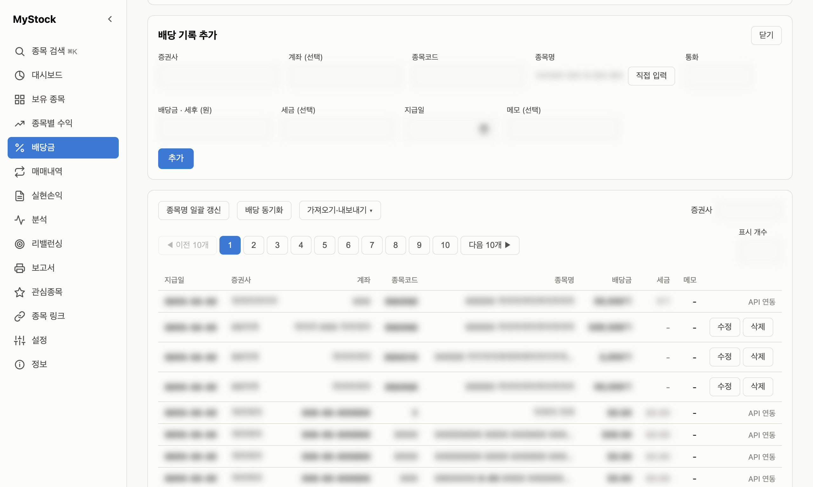

### 배당 기록 추가
1. 증권사를 고르고, **계좌(선택)** 를 적습니다. 계좌를 적어 두어야 보유 종목 화면의 "배당 포함 손익금액"에 그 계좌 배당으로 들어갑니다.
   - 계좌를 비우면, 그 증권사 계좌가 하나뿐일 때만 그 계좌 배당으로 칩니다.
2. **종목코드**를 입력하면 종목명이 자동으로 채워집니다(못 찾으면 직접 입력).
3. 통화(KRW/USD), 배당금, 지급일, 메모를 적고 추가합니다.

- 목록의 각 행은 **수정**으로 그 자리에서 고칠 수 있습니다.
- **종목명 일괄 갱신**: 저장된 기록의 종목명을 최신 이름으로 다시 채웁니다.
- **CSV 내보내기/가져오기**: 컬럼 `broker, accountId, symbol, currency, amount, paidDate, memo`(+ 선택 `tax`). `amount`는 세후입니다. 토스증권·NH투자증권·키움증권 행과 한국투자증권의 원화 행은 가져오지 않습니다(한국투자증권 달러 행은 가져옴).

---

## 7. 매매내역

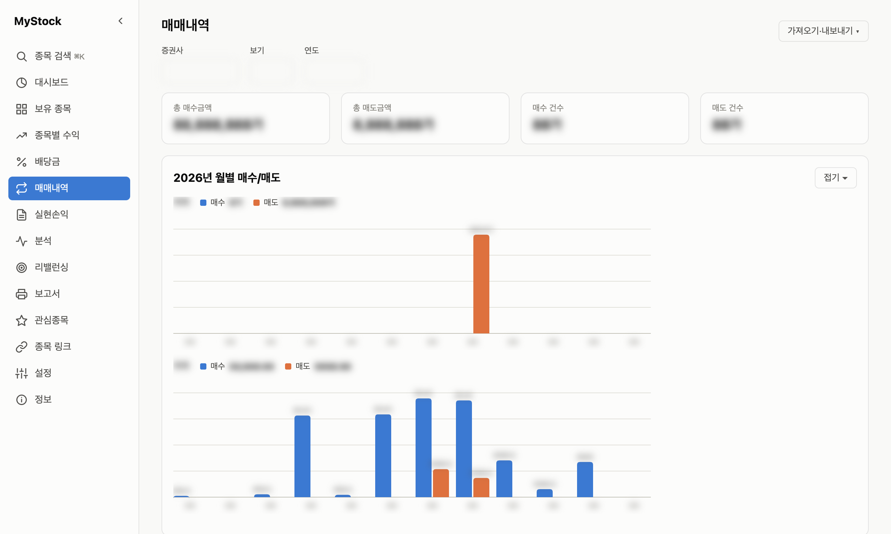

- 위쪽에서 **증권사**(또는 **전체**), 계좌, 보기(연간/월간), 연도를 고릅니다.
- 한국투자증권은 국내 체결과 **미국 주식 체결(달러, 현지 주문일 기준)**을 함께 가져옵니다.
- NH투자증권도 국내(종합거래내역의 매매)와 미국 주식(해외 거래내역의 매수·매도)을 함께 가져옵니다. 모의투자 계좌를 고르면 그 계좌 체결을 보여 주지만
  "전체" 보기·실현손익에는 넣지 않습니다.
- 상단 카드: 총 매수금액, 총 매도금액, 매수 건수, 매도 건수
- **월별 매수/매도** 그래프는 원화와 달러를 섞지 않고 위아래로 따로 그립니다.

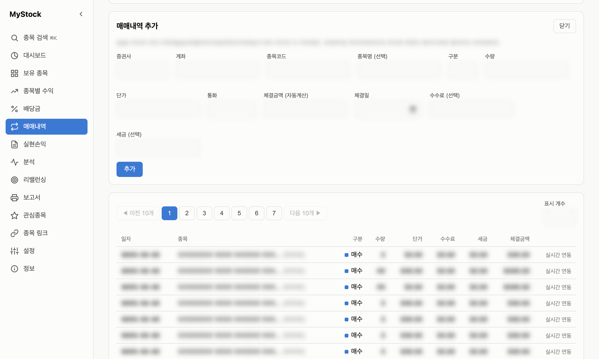

- 목록의 "체결금액"은 수량×단가에 **수수료와 세금을 더한** 금액입니다(마우스를 올리면 내역이 보임).
- **매매내역 추가**(CSV 전용 증권사만): 수량과 단가를 넣으면 체결금액이 자동 계산됩니다.
- CSV 전용 증권사 행은 **수정/삭제**할 수 있고, 토스·KIS·NH·키움 행과 **KB증권의 API 연동 계좌** 행은 실시간 연동(동기화)이라 고칠 수 없습니다("실시간 연동"으로 표시).
- **CSV 가져오기**: 컬럼 `broker, accountId, symbol, name, side, quantity, price, amount, currency, executedAt, commission, tax` (+ 선택 `id` — 같은 거래를 다시 가져올 때 중복을 막음)
- "전체" 보기는 이 컴퓨터에 저장된 매매내역 기준이라, 토스·KIS·NH·키움은 한 번이라도 조회한 연도만 나타납니다.

### 적립식 계획

매매내역 화면 위쪽 **적립식 계획** 카드에서 "이 종목을 매달 얼마씩 산다"(종목코드, 월 적립액, 시작 달)를 적어 두면, 모든 계좌의 실제 매수와 달마다 맞춰
**달성**(계획의 95% 이상)·**부족**·**누락**·**진행 중**(이번 달)으로 보여 줍니다. 지난 달까지 합계·달성률, 연속 달성 개월 수, 이번 달 남은 금액도 나옵니다.
매매내역이 앱에 모여 있어야 정확합니다(증권사 API 계좌는 그 기간을 매매내역 화면에서 한 번 조회해야 쌓입니다). 달러 매수는 그 달 평균 환율로 환산합니다.

---

## 8. 실현손익

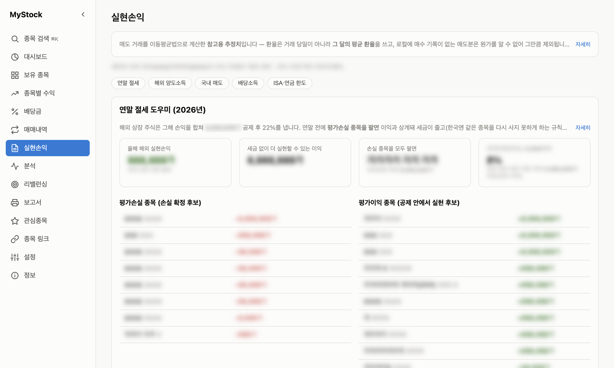

매도한 거래의 실현손익을 **이동평균법**으로 계산합니다. **참고용 추정치**이며, 실제 세금 신고는 증권사가 발급하는 공식 자료로 확인하세요.

- **해외 상장 종목 실현손익(일반계좌)** 과 **추정 세액**(기본공제 250만 원 후 22%)을 보여줍니다.
- 환율은 거래 당일이 아니라 **그 달의 평균 환율**을 씁니다(한국수출입은행 환율 인증키가 있을 때).
- 국내 상장 종목 매도와 ISA·연금저축·IRP 계좌 매도는 22% 계산에서 빼고 따로 보여줍니다. 계좌의 세금 유형은 [설정](#2-증권사-연결하기-설정)에서 정합니다.
- 배당소득은 양도소득과 따로 보여주며, 금융소득종합과세 기준(연 2,000만 원) 대비 비율을 함께 표시합니다.
- 매수 기록이 없는 매도분은 원가를 알 수 없어 계산에서 빠집니다.
- **연말 절세 도우미**(올해 기준): 해외 상장 주식의 올해 실현손익과 추정 세금, **세금 없이 더 실현할 수 있는 이익**(250만 원 공제 중 남은 몫),
  평가손실 종목을 **모두 팔면 줄어드는 세금**, 손실·이익 후보 종목, 금융소득(배당) 2,000만 원 대비 비율을 보여 줍니다. 일반 계좌의 해외 상장 보유만 대상이고
  평가손익은 지금 환율로 환산한 근사치입니다. 세금은 **결제일 기준**이라 연말 마지막 거래일보다 며칠 앞서 팔아야 그해에 잡힙니다 — 증권사 공지를 확인하세요.
- **ISA·연금 한도**: 설정에서 세금 유형을 ISA·연금저축·IRP로 정한 계좌가 나옵니다.
  - **ISA**: 가입일부터의 매매 손익과 배당(세전)을 합친 순이익이 **비과세 한도**(일반형 200만·서민형 400만 원)에 얼마나 찼는지, 넘으면 넘는 몫 × 9.9% 추정 세금을 보여 줍니다.
    "지금 해지하면"은 아직 팔지 않은 평가손익까지 더한 값입니다. 유형(일반형·서민형)과 **가입일**은 표에서 고르고, 올해 **납입액**을 적으면 연 납입 한도 대비도 보입니다.
  - **연금저축·IRP**: 계좌마다 올해 **납입액**을 적으면 세액공제 대상 금액(연금저축 600만 원, IRP 합쳐 900만 원까지), 더 넣을 수 있는 금액, 예상 세액공제
    (총급여 5,500만 원 이하 16.5%, 초과 13.2%)를 보여 줍니다. 납입액은 증권사 API로 알 수 없어 직접 적습니다.
  - **한도 수치 바꾸기**: 세법이 바뀌면 직접 고칩니다. ISA 한도를 올리는 개편(비과세 500만·1,000만 원, 납입 4,000만 원)은 시행 여부를 앱이 알 수 없어 기본값으로 쓰지 않습니다.
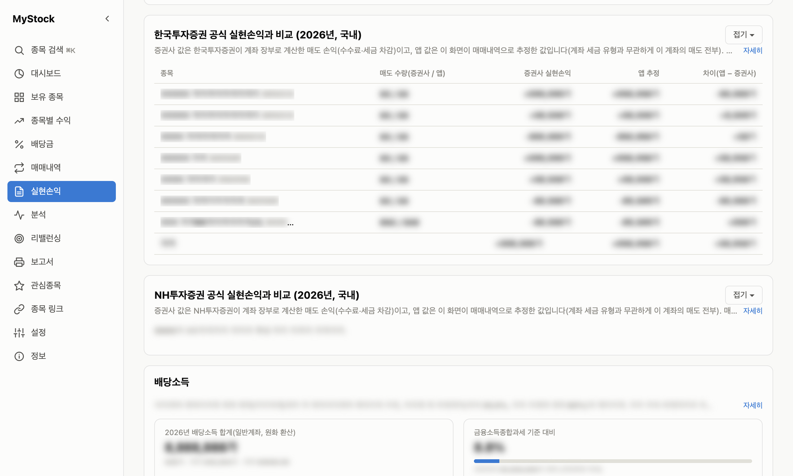

- **한국투자증권 공식 실현손익과 비교** (한국투자증권 API 키 필요): 그 해 한국투자증권 계좌의 매도를 증권사가
  계산한 실현손익(수수료·세금 차감)과 앱 추정치를 종목별로 나란히 보여줍니다. 차이가 크면 매매내역이 덜 모였거나
  원가 기준이 다른 것이니 증권사 값을 기준으로 보세요.
  - 국내 매도 카드는 항상, **해외(미국) 매도 카드**는 그 해 한국투자증권 달러 매도가 있을 때 보입니다(증권사 값도 원화 환산).
- **NH투자증권 공식 실현손익과 비교** (NH API 키 필요): 같은 카드로 NH 실전 계좌들의 **국내** 매도를 비교합니다. NH는 종목별 기간 합계로
  알려 줍니다. 해외(미국) 매도는 NH API가 종목별 값을 주지 않아 비교 카드가 없습니다.
- **키움증권 공식 실현손익과 비교** (키움 API 키 필요): 국내 매도(매도 건별)와, 그 해 키움 달러 매도가 있으면 미국 매도(원화 환산)도 비교합니다.

---

## 9. 분석

사이드바의 **분석**에서 내 포트폴리오를 숫자로 점검합니다. 대시보드와 같은 데이터(모든 증권사·계좌)를 씁니다.

- **벤치마크 대비 성과**: 1·3·6개월, 올해 누적 수익률을 **코스피·코스닥·S&P500(SPY)·나스닥100(QQQ)** 과 나란히 봅니다.
  내 수익률은 대시보드 "지수와 비교"와 같은 월간 근사(새로 넣은 돈은 뺌)이고, 지금 보유 종목의 매매내역으로 최근 12개월을 다시 계산하므로 다 판 종목은 빠집니다.
  S&P500·나스닥100은 달러 기준 ETF 수익률입니다(환율 미반영).
- **위험 지표**: 연환산 **변동성**, **최대 낙폭(MDD)**, 코스피 대비 **베타·상관계수**, 가장 좋았던/나빴던 달. 평가 상위 6종목의 변동성과 **종목끼리 상관계수**도 보여 줍니다
  (0.7 이상은 붉게 — 함께 오르내려 분산 효과가 작습니다). 월간 자료가 12개월뿐이라 참고용입니다.
- **분산 현황**: 통화(원화/달러), **자산군**(주식·채권·리츠·인프라·커버드콜·현금성·원자재 — 종목 이름으로 짐작), 증권사, 계좌 유형(일반·ISA·연금)별 비중과
  최대 종목·상위 5종목 비중, **실질 종목 수**(비중이 고르다고 쳤을 때 몇 종목에 나눈 셈인지).
- **비용 분석**: 연도별 거래금액, **수수료**, 매매 세금, **배당 원천징수**, 비용률. 증권사가 수수료·세금을 알려 주지 않는 거래는 0으로 세고 그 건수를 따로 보여 줍니다.
- **은퇴·목표 자산 시뮬레이션**: 시작 자산(비우면 지금 평가금액), 월 적립액, 연 총수익률, 배당수익률, 적립액 증가율, 물가상승률, 기간을 넣으면 해마다 자산과 월 배당(세후)을
  계산합니다. **비관·보통·낙관**(수익률 ±2%p)을 함께 보여 주고, **목표 자산·목표 월 배당**(오늘 돈 가치)을 적으면 몇 년 뒤 닿는지 알려 줍니다. **입력 저장**을 누르면 다음에도 남습니다.
  매매 세금·수수료를 뺀 단순 계산이며 미래 수익을 보장하지 않습니다.

---

## 10. 리밸런싱

사이드바의 **리밸런싱**에서 종목별 **목표 비중**을 정해 두고, 지금 보유와 비교해 얼마를 사고팔면 맞춰지는지 봅니다.
모든 증권사·계좌의 같은 종목을 합친 평가금액(달러 종목은 원화 환산)을 기준으로 합니다.

- 표의 **목표 비중(%)** 칸에 숫자를 적으면 바로 다시 계산되고, **목표 저장**을 눌러야 다음에도 남습니다. 보유하지 않은 종목은 **종목코드 추가**로 넣습니다.
- **목표를 적은 종목끼리만** 맞춥니다. 목표가 없는 종목은 "유지"로 두고 손대지 않습니다. 목표 합이 100%가 아니면 100%로 비례 환산해 계산합니다.
- **맞추려면**: 목표 금액과의 차이(매수·매도 금액)와 현재가 기준 대략 수량입니다.
- **추가 투자금**을 넣으면 그 돈까지 기준 금액에 더하고, **팔지 않고 부족한 종목만 사서** 맞출 때 종목별로 얼마씩 넣으면 되는지 보여 줍니다.
- 참고용 계산입니다. 수수료·세금·호가 단위는 반영하지 않고, 앱은 주문하지 않습니다.

---

## 11. 보고서

사이드바의 **보고서**에서 **월간** 또는 **연간** 보고서를 보고 **PDF로 저장**합니다.

- 담기는 내용: 그 기간에 받은 배당(세후, 월별·종목별 상위 10), 매수·매도 금액, 실현손익(일반 계좌, 해외·국내 상장 따로 — 연간 보고서는 해외주식 양도소득세 추정 포함),
  순자산 변화(앱이 하루 한 번 기록한 순자산 기준), 작성 시점 보유 상위 10.
- **PDF로 저장**을 누르면 저장 위치를 묻습니다. 사이드바·버튼은 빼고 보고서 부분만, 화면이 다크 모드여도 밝은 색으로 저장됩니다.
- 보유 현황은 **작성 시점** 값입니다(지난달 말 보유를 다시 계산하지 않습니다). 달러는 그 달 평균 환율(없으면 작성일 환율)로 환산합니다.
- PDF에는 내 계좌의 금액·종목이 그대로 들어갑니다. 다른 사람에게 보낼 때 주의하세요.

---

## 12. 관심종목

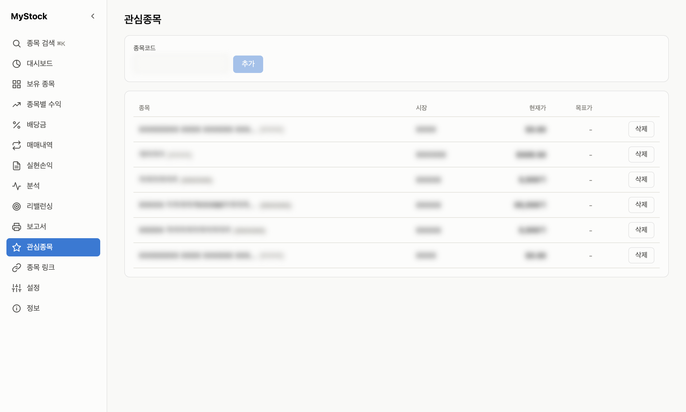

보유하지 않은 종목의 현재가를 지켜봅니다.

1. **종목코드**를 입력하고 **추가**를 누릅니다(종목명은 자동으로 채워짐).
2. 목록에서 종목 행을 누르면 아래에 상세(현재가, 시장, 통화)와 **월별 종가 차트**가 열립니다. 차트 기간은 최근 12개월 / 전체 기간 / 연도별로 바꿀 수 있습니다.
3. 오른쪽 **삭제**로 목록에서 뺍니다.

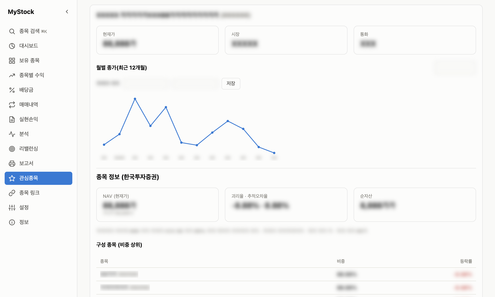

**국내 종목 정보 (한국투자증권 API 키 필요)** — 국내 종목의 상세 아래에 **종목 정보** 칸이 붙습니다.
- **주식**: 현재가 기준 **투자지표**(PER·PBR·EPS·BPS·시가총액·52주 최고/최저·외국인 소진율), 연간 재무비율(매출·영업이익·순이익 증가율, ROE,
  EPS, BPS, 부채비율)과 최근 6개월 **증권사 투자의견·목표가**. 재무비율은 한국투자증권 재무 API가 응답하지 않으면 "불러오지 못했습니다"로 나옵니다
  (2026년 11월 현재 그렇습니다 — 투자지표는 그대로 보입니다).
  가장 최근 줄은 결산 전 누적 값일 수 있습니다. 투자의견은 증권사 리포트를 옮긴 것이며 투자 권유가 아닙니다.
- **ETF**: **NAV**, 괴리율, 추적오차율, 순자산, 기초지수·운용사·분배 주기와 **구성 종목**(비중 상위 30개 — 한국투자증권이 그만큼만 줍니다).
- 둘 다 최근 **뉴스·공시 제목**을 보여줍니다(본문은 증권사 앱에서 확인). 해외 종목은 대상이 아닙니다.

종목명 옆 빨간 배지는 보유 종목 화면과 같은 **매수 유의사항**입니다.

**목표가 알림**: 종목 상세 위쪽에 **이상**·**이하** 가격을 적고 저장하면, 현재가가 그 값에 닿을 때 컴퓨터 알림으로 알려 줍니다([알림](#알림)). 조건마다 하루 한 번, 5분마다 확인합니다.
둘 다 비우고 저장하면 지웁니다.

---

## 13. 종목 링크

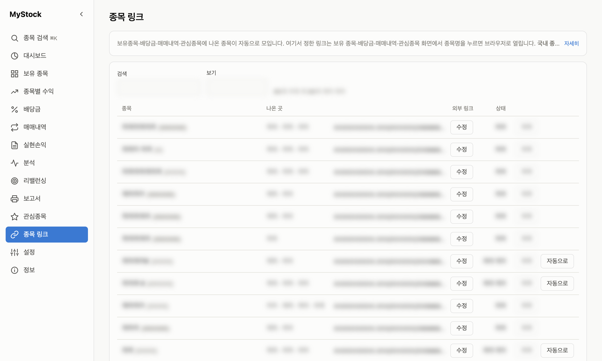

다른 화면에서 종목명을 눌렀을 때 열릴 웹페이지를 정합니다. 보유 종목·배당금·매매내역·관심종목에 나온 종목이 자동으로 모입니다.

- 칸을 비워 두면 **자동 링크**(토스증권 웹 종목 페이지)를 씁니다. 국내 종목은 자동으로 만들어지고, 미국 종목은 확인된 일부만 자동입니다.
- 원하는 주소를 붙여넣고 저장하면 그 주소로 열립니다.
- 빈 값으로 저장하면 "링크 없음", **자동으로** 버튼은 입력값을 지우고 자동 링크로 되돌립니다.

---

## 14. 데이터 백업·복원과 Google Sheets

### 데이터 백업/복원 (설정 화면 맨 아래 "데이터 백업/복원" 카드)

MyStock의 데이터는 이 컴퓨터에만 저장됩니다. PC를 바꾸거나 다시 설치하기 전에, 또는 CSV·Google Sheets로 데이터를
크게 바꾸기 전에 백업을 받아 두세요.

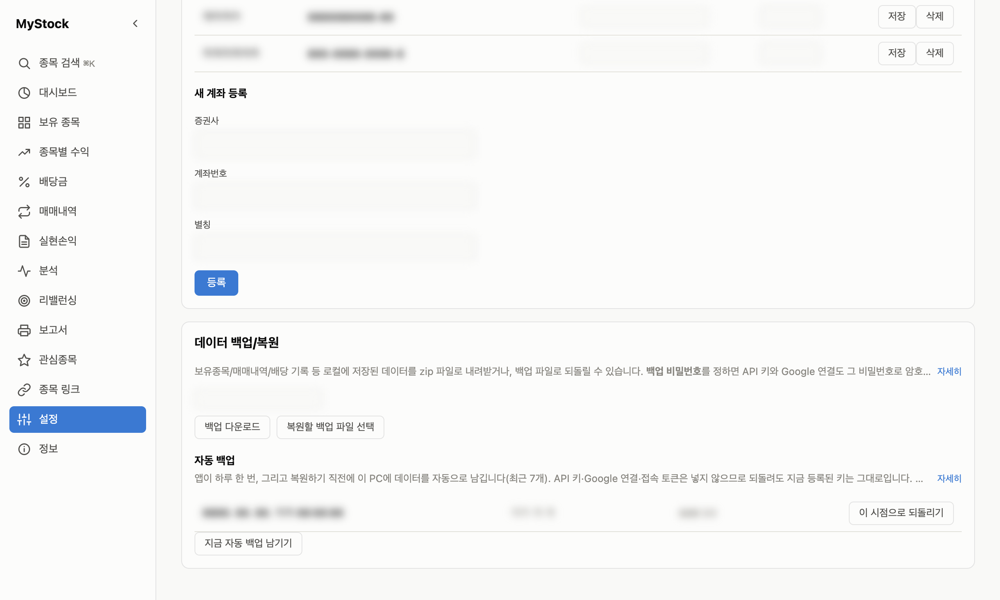

#### 백업에 들어가는 것과 빠지는 것

| 항목 | 백업 비밀번호 없이 | 백업 비밀번호를 정하면 |
|---|---|---|
| 보유 종목·매매내역·배당 기록, 계좌 별칭·세금 유형, 관심종목, 종목 링크, 자산 스냅샷, 설정(수동 환율 등), 종목명 캐시 | ✅ 들어감 | ✅ 들어감 |
| 증권사 API 키, 한국수출입은행 환율 인증키, Google OAuth 클라이언트·계정 연결 | ❌ 빠짐 | ✅ 그 비밀번호로 암호화해 들어감 |
| 증권사 접속 토큰(한국투자증권·KB증권·NH투자증권·키움증권·LS증권·DB증권) | ❌ 항상 빠짐 | ❌ 항상 빠짐 |

- API 키는 평소 이 PC의 OS 키체인으로 잠겨 있어 다른 PC에서는 열 수 없습니다. 백업 비밀번호를 정하면 키를 그 비밀번호로
  다시 암호화(scrypt + AES-256-GCM)해 넣으므로, **다른 PC에서도 비밀번호만 알면 키까지 복원**됩니다.
- 접속 토큰은 하루 안팎이면 만료되고 필요할 때 앱이 다시 받기 때문에 넣지 않습니다.

#### 백업 받기

1. **설정**을 열고 맨 아래 **데이터 백업/복원** 카드로 갑니다.
2. API 키도 함께 옮기려면 **백업 비밀번호**(8자 이상)를 입력하고, 나타나는 **비밀번호 확인** 칸에 한 번 더 입력합니다.
   데이터만 백업하려면 비워 둡니다.
3. **백업 다운로드**를 누르면 `mystock-backup-YYYY-MM-DD.zip` 파일이 내려받아집니다.

> ⚠ 백업 비밀번호는 어디에도 저장되지 않습니다. **잊으면 그 백업의 API 키는 복원할 수 없습니다.** 데이터(보유 종목 등)도
> 비밀번호를 입력해야 복원되므로, 비밀번호를 잊었다면 비밀번호 없이 새 백업을 다시 받아 두세요.
> 비밀번호로 만든 백업 파일도 다른 사람에게 보내지 마세요. 보유 종목·매매내역·계좌 정보는 암호화되지 않은 채 들어 있습니다.

#### 복원하기

1. **복원할 백업 파일 선택**을 누르고 `mystock-backup-….zip` 파일을 고릅니다. 파일을 고르는 것만으로는 복원되지 않습니다.
2. "현재 저장된 모든 데이터가 이 백업 파일 내용으로 완전히 대체됩니다"라는 확인 상자가 나타납니다.
   백업할 때 비밀번호를 정했다면 **백업 비밀번호**를 입력하고, 아니면 비워 둡니다.
3. **정말 복원하기**를 누릅니다. 그만두려면 **취소**를 누릅니다.
4. 완료 메시지를 확인합니다.
   - 설치본은 **잠시 후 앱이 자동으로 다시 시작**됩니다. 소스에서 실행한 경우는 앱을 직접 다시 시작하세요.

복원할 때 알아둘 것:

- 지금 데이터가 백업 시점의 데이터로 **덮어써집니다.** 복원 전에 지금 상태도 백업해 두면 되돌릴 수 있습니다.
- **비밀번호로 만든 백업을 복원하면** API 키, 한국수출입은행 환율 인증키, Google OAuth 클라이언트와 연결도 백업 내용으로 바뀝니다. 백업에 없는 증권사의 키는 지워지고,
  이전 키로 받아 둔 접속 토큰도 지워져 새 키로 다시 받습니다.
- **비밀번호 없이 만든 백업을 복원하면** 데이터만 바뀌고, 지금 PC에 등록된 API 키·환율 인증키·Google 클라이언트와 연결은 그대로 남습니다.
  새 PC라면 복원 후 **설정 → API 키 등록**에서 키를 다시 입력하세요.
- 비밀번호가 틀리면 "백업 비밀번호가 올바르지 않습니다."가 뜨고, **아무것도 바뀌지 않습니다.** 비밀번호로 만든 백업인데 칸을 비워 두면
  비밀번호를 입력하라는 안내가 뜹니다.
- 키링이 없는 Linux에서는 키를 안전하게 저장할 수 없어서, 데이터만 복원하고 API 키·환율 인증키·Google 클라이언트와 연결은 복원하지 않습니다.

#### 자동 백업 (가져오기를 잘못했을 때 되돌리기)

앱이 **하루 한 번**, 그리고 **복원하기 직전**에 데이터를 이 PC에 자동으로 남깁니다(최근 7개만 보관).

- **설정 → 데이터 백업/복원** 카드 아래 **자동 백업** 목록에서 시점을 고르고 **이 시점으로 되돌리기 → 정말 되돌리기**를 누릅니다.
  되돌리기 직전의 지금 상태도 자동 백업으로 한 벌 남으므로, 되돌린 것을 다시 되돌릴 수 있습니다.
- 자동 백업에는 **API 키·환율 인증키·Google 연결·접속 토큰이 들어가지 않습니다.** 되돌려도 지금 등록된 키는 그대로입니다.
  다른 PC로 옮기는 용도가 아니라 이 PC에서 실수를 되돌리는 용도입니다(옮길 땐 아래처럼 비밀번호 백업을 받으세요).
- 앱을 켜고 1분쯤 뒤에 그날의 첫 자동 백업이 생깁니다. 지금 바로 남기려면 **지금 자동 백업 남기기**를 누릅니다.
- 위치: 사용자 데이터 폴더 옆의 `backups` 폴더(본인 계정만 읽을 수 있음).

#### PC를 옮길 때

1. 쓰던 PC에서 **백업 비밀번호를 정해** 백업을 받습니다.
2. 새 PC에 MyStock을 설치하고 한 번 실행합니다([서명하지 않은 앱 처음 실행하기](#서명하지-않은-앱-처음-실행하기) 참고).
3. **설정 → 데이터 백업/복원**에서 백업 파일과 비밀번호로 복원합니다. 앱이 다시 시작되면 API 키와 데이터가 그대로 보입니다.
4. macOS는 다시 시작한 뒤 키체인 접근을 물을 수 있습니다. **항상 허용**을 누르세요.

### Google Sheets 연동

> 🧪 **실험적 기능(Experimental)입니다.** 쓰려면 **본인 Google Cloud 프로젝트에서 OAuth 클라이언트를 만들어** 그
> Client ID/Secret을 설정에 넣어야 합니다(무료, 한 번만). 만드는 순서는 [부록의 "Google API 키(OAuth 클라이언트) 설정하기"](#google-api-키oauth-클라이언트-설정하기)에
> 있습니다. 클라이언트 없이도 같은 데이터를 **CSV 내보내기/가져오기**로 옮길 수 있습니다.

1. 설정의 **Google Sheets 연동**에 **Client ID**와 **Client Secret**을 붙여 넣고 **클라이언트 저장**을 누릅니다.
   - 저장하면 Client ID가 보이고 Secret은 다시 보이지 않습니다. 값은 이 PC의 OS 키체인으로 암호화해 저장합니다.
   - 다른 클라이언트로 **바꾸기**를 하면 기존 Google 연결이 끊어집니다(새 클라이언트로 다시 연결해야 합니다).
2. **Google 계정 연결**을 누르면 브라우저에서 로그인 창이 열립니다. 본인이 만든 클라이언트라 "Google에서 확인하지 않은 앱" 화면이
   나올 수 있습니다 — **고급 → (앱 이름)(으)로 이동**을 눌러 계속합니다.
3. 연결되면 Google Drive에 "MyStock" 스프레드시트가 만들어지고, **MyStock 스프레드시트 열기** 링크가 보입니다.
4. 보유 종목·매매내역·배당금 화면의 **Google Sheets로 내보내기 / Google Sheets에서 가져오기** 버튼을 씁니다.

> ⚠ **Google Sheets에서 가져오기는 CSV 가져오기와 다릅니다.** 직접 관리하는(CSV 전용) 계좌의 데이터를
> 시트 내용으로 **완전히 교체**하고, 잘못된 행이 하나라도 있으면 전부 취소됩니다.

---

## 15. 편의 기능과 문제 해결

### 메뉴를 옮겨도 화면이 그대로 남습니다
- 한 번 연 화면은 다른 메뉴로 갔다가 돌아와도 **보던 내용·고른 증권사/계좌/연도·스크롤 위치가 그대로** 바로 보입니다.
  처음 들어갈 때만 불러오는 시간이 걸립니다.
- 돌아왔을 때 마지막으로 받은 지 30초가 지났으면, 보이는 내용은 그대로 둔 채 **뒤에서 새로 받아** 바뀐 값만 고칩니다
  (배당금 화면의 증권사 배당 동기화는 10분 간격). 설정·CSV 가져오기 등으로 데이터를 바꿨다면 시간과 상관없이 다시 받습니다.
- 보이지 않는 화면은 1분 자동 새로고침 같은 주기적인 조회를 쉽니다.

### 빠른 종목 검색 (⌘K)

어느 화면에서든 **⌘K**(Windows·Linux는 **Ctrl+K**) 또는 사이드바 맨 위 **종목 검색**을 누르면 검색 창이 열립니다. 종목코드나 이름 일부를 치면 보유·관심·배당·매매에 나온
종목이 나오고(↑↓로 이동, Enter로 선택, Esc로 닫기), 고르면 그 종목의 **계좌별 보유·손익, 최근 12개월 배당, 최근 매매**를 바로 보여 줍니다. 아래 버튼으로 보유 종목·종목별 수익·
배당금·매매내역·관심종목 화면으로 이동합니다. 증권사 API 계좌 값은 마지막으로 조회한 시점 기준입니다.

### 알림

설정의 **알림** 카드에서 켜고 끕니다. 컴퓨터의 알림 센터로 뜨고, 앱이 켜져 있을 때만 동작합니다(창을 닫아도 앱이 떠 있으면 동작). 처음엔 운영체제가 알림을 허용할지 물을 수 있습니다.

- **배당 입금**: 배당 동기화로 새 배당 기록이 생기면(최근 7일 지급분) 알립니다. 앱이 켜져 있으면 한국 시간 9~21시에 4시간마다 백그라운드로 배당을 동기화합니다
  (NH투자증권은 토큰이 만료됐을 때 새로 받으며 보안 알림이 올 수 있습니다 — 배당금 화면에 들어갈 때와 같습니다).
- **관심종목 목표가**: [관심종목](#12-관심종목) 상세에서 정한 가격에 닿으면.
- **주간 요약**: 금요일 저녁(18시 이후) 한 번, 이번 주 자산 변화(하루 한 번 기록하는 순자산 기준), 받은 배당, 다음 주 배당 예정, 이번 달 적립이 남은 계획을 알려 줍니다.
- **보유 종목 매수 유의사항**: 보유 종목에 투자경고 등 유의사항이 새로 붙으면(토스증권 키 필요, 2시간마다 확인). 처음 켤 때 이미 붙어 있던 것은 알리지 않습니다.
- 알림에는 종목·금액이 보이지만 이 컴퓨터에만 뜨고 외부로 보내지 않습니다.

### 화면 확대/축소
- 트랙패드 핀치, **⌘(Ctrl) + 휠**, **⌘(Ctrl) + `+` / `-` / `0`** 으로 내용 영역을 확대/축소합니다(`0`은 100%로).
- 사이드바는 크기가 그대로이고, 확대하면 내용이 화면 밖으로 넘쳐 스크롤됩니다.
- 사이드바 위쪽 **〈** 버튼으로 사이드바를 아이콘만 남기고 접을 수 있습니다.

### 내 데이터와 API 키는 어떻게 보호되나요

- **API 키·증권사 접속 토큰·한국수출입은행 환율 인증키·Google OAuth 클라이언트와 연결**은 OS 키체인(macOS 키체인, Windows 자격 증명 보호, Linux 키링)으로 암호화해 저장합니다.
  Linux에 키링이 없으면 평문으로 남기지 않으려고 키 저장을 거부하고, 접속 토큰은 디스크에 쓰지 않습니다(앱을 다시 켜면 새로 받습니다).
- **보유 종목·거래·배당 기록**이 있는 데이터 폴더는 이 PC의 본인 계정만 읽고 쓸 수 있게 만듭니다.
- 앱 화면은 이 앱의 파일과 이 PC의 MyStock 백엔드 말고는 아무것도 불러오지 않습니다. 외부 링크는 브라우저로 열립니다.
- 설치본은 개발자 도구가 열리지 않고, 원격 디버깅 옵션(`--remote-debugging-port` 등)을 붙여 실행하면 바로 종료됩니다 —
  다른 프로그램이 앱을 조종해 키를 꺼내 가지 못하게 하려는 것입니다. macOS 설치본은 다른 프로그램의 코드를 끼워 넣어 실행할 수도 없습니다.
- 통신 보안을 약하게 만드는 환경 변수(`NODE_TLS_REJECT_UNAUTHORIZED=0`, `NODE_EXTRA_CA_CERTS`, `NODE_USE_ENV_PROXY`, `NODE_DEBUG`)가
  설정되어 있으면 "MyStock을 실행할 수 없습니다" 창을 띄우고 종료합니다. 그 변수를 지우고 다시 실행하세요.
- 백업 복원은 형식이 맞지 않는 파일, 풀면 지나치게 커지는 파일, 암호화되지 않은 API 키 파일을 받지 않습니다.
- 백업 파일은 비밀번호를 정해도 보유 종목 등은 암호화되지 않습니다. 다른 사람에게 보내지 마세요([데이터 백업/복원](#데이터-백업복원-설정-화면-맨-아래-데이터-백업복원-카드)).

### 화면에 "이 화면을 표시하다 오류가 났습니다"가 뜰 때
그 화면만 문제가 생긴 것이라 다른 메뉴는 그대로 쓸 수 있습니다. **다시 불러오기**를 눌러 보고, 계속 같으면 **정보 → 로그 폴더 열기**로
`main.log`를 열어 문의할 때 첨부해 주세요(오류 내용이 가려진 형태로 기록돼 있습니다).

### 앱이 실행되지 않을 때 (설치 직후)

| 증상 | 해결 |
|---|---|
| macOS 12(Monterey) 이하: 앱이 열리지 않거나 바로 꺼짐 | MyStock은 **macOS 13 이상**이 필요합니다. 시스템 설정 → 일반 → 소프트웨어 업데이트로 macOS를 올리세요. |
| macOS: "'MyStock'을(를) 열지 않음" | 완료 → 시스템 설정 → 개인정보 보호 및 보안 → **그래도 열기** ([자세히](#macos)) |
| macOS: "손상되었기 때문에 열 수 없습니다" | 터미널에서 `xattr -dr com.apple.quarantine "/Applications/MyStock.app"` |
| Windows: "Windows의 PC 보호" | **추가 정보 → 실행**, 버튼이 없으면 파일 속성의 **차단 해제** ([자세히](#windows)) |
| Linux: AppImage가 실행되지 않음 | `chmod +x`, FUSE 오류면 `libfuse2`/`libfuse2t64` 설치 ([자세히](#linux)) |
| "통신 보안을 약하게 만드는 환경 변수…" 창이 뜨고 종료됨 | 창에 적힌 환경 변수를 지우고 다시 실행합니다. 터미널에서 띄웠다면 그 셸의 변수(`unset 이름`)를, Windows는 시스템 환경 변수를 확인합니다. ([자세히](#내-데이터와-api-키는-어떻게-보호되나요)) |
| 증권사 조회가 갑자기 실패함(새 버전 설치 후) | macOS 키체인 접근을 거부했을 수 있습니다. **설정 → API 키 등록**에서 키를 다시 저장하세요. |

### 증권사 조회가 안 될 때 (IP 등록·보안 알림)

증권사마다 API를 쓸 수 있는 PC를 IP로 제한하거나, 접속할 때 알림을 보냅니다. 화면에 뜨는 오류 문구에 증권사 오류 코드가 함께 나옵니다.

| 증권사 | 증상 | 해결 |
|---|---|---|
| 토스증권 | 보유 종목·계좌 조회가 실패함(허용되지 않은 IP) | 토스증권 WTS의 **설정 > Open API > 허용 IP 관리**에 지금 PC의 공인 IP를 등록합니다. 집 인터넷처럼 IP가 바뀌는 환경이면 바뀔 때마다 다시 등록하세요. |
| 키움증권 | 조회가 실패하고 오류 코드 **8010**(토큰을 받은 IP와 다름)이나 IP 관련 문구가 보임 | 키움 OpenAPI 포털의 **계좌 APP Key 관리**에서 지금 PC의 IP를 추가합니다(여러 개 등록 가능). IP가 바뀌면 앱이 토큰을 자동으로 다시 받지만, 포털에 없는 IP면 계속 실패합니다. 오류 코드 **8001·8002**는 앱키·시크릿키가 틀린 경우라 설정에서 다시 저장하세요. ⚠ 키움 연동은 아직 실제 계좌로 확인 전이라, 위에 없는 오류가 나면 알려 주세요. |
| NH투자증권 | NH에서 **보안 알림**(접근 토큰 발급 알림)이 옴 | 정상입니다. NH는 접근 토큰을 새로 받을 때마다 알림을 보냅니다. MyStock은 토큰을 24시간 저장해 재사용하므로 보통 하루 한 번 정도 옵니다. 앱키를 바꾸면 새 토큰을 받으면서 한 번 더 옵니다. 내가 앱을 쓰지 않았는데 알림이 오면 NH 포털에서 앱키를 재발급하세요. |

> 지금 PC의 공인 IP는 브라우저에서 "내 IP"를 검색하면 확인할 수 있습니다.

### "환율 미적용"이 보일 때
실시간 환율을 가져오지 못해 달러 금액을 원화로 합치지 못한 것입니다. **설정 → 한국수출입은행 환율 인증키**를 넣었는지 확인하고(토스증권 환율이 없을 때 대신 씁니다), 그래도 안 되면 **설정 → USD/KRW 환율**에 환율을 직접 입력하세요.

### 섹터 비중에 "분류 안 됨"이 클 때
미국 지수·커버드콜 ETF처럼 토스증권 섹터 분류에 없는 ETF와, 국내 ETF의 비중 상위 30개 밖 종목·채권·현금이 여기에 들어갑니다.
국내 ETF를 구성종목으로 나누려면 한국투자증권 API 키가 필요합니다. 그날 처음 열었다면 ETF 섹터 분류를 받는 약 2분 동안은 더 크게 보일 수 있습니다.

### 배당 포함 손익에 배당이 안 들어갈 때
배당 기록의 **계좌**가 비어 있고 그 증권사에 계좌가 여러 개면 어느 계좌 배당인지 알 수 없어 더하지 않습니다. 배당금 화면에서 그 기록의 계좌를 채워 주세요. 토스증권은 설정의 계좌 별칭에 **표시용 계좌번호**를 입력해 두면 그 번호로 적은 배당도 인식합니다.

### 앱 정보

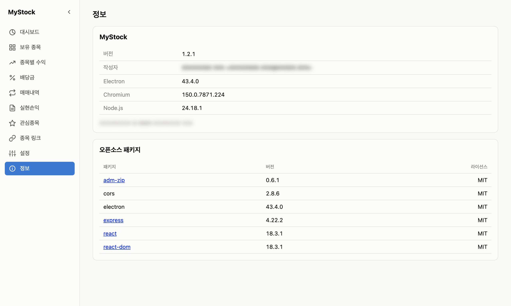

사이드바 맨 아래 **정보**에서 앱 버전, Electron/Chromium/Node 버전, 사용 중인 오픈소스 패키지와 라이선스를 볼 수 있습니다.

**업데이트와 로그** 카드:
- **새 버전 알림**: 켜 두면(기본) GitHub 릴리스를 6시간마다 확인해, 새 버전이 나오면 사이드바 메뉴 아래에 **⬆ 새 버전 vX.Y.Z 받기**
  링크가 나타납니다(누르면 브라우저로 릴리스 페이지가 열립니다). 설치는 직접 합니다([새 버전으로 업데이트](#새-버전으로-업데이트)).
  확인할 때 GitHub에는 이 PC의 IP만 전달됩니다. 원하지 않으면 체크를 끄세요. **지금 확인**으로 바로 확인할 수도 있습니다.
- **로그 폴더 열기**: 앱이 남기는 로그 파일(`main.log`)이 있는 폴더를 엽니다. 문제가 생겨 문의할 때 이 파일을 첨부해 주세요.
  계좌번호·금액·날짜처럼 긴 숫자, 이메일, 토큰처럼 보이는 값, 컴퓨터 계정 이름은 가려서 기록합니다.
  위치: macOS `~/Library/Logs/@mystock/electron`, Windows `%APPDATA%\@mystock\electron\logs`, Linux `~/.config/@mystock/electron/logs`.

---

## 부록. API 키 발급 안내

MyStock은 **어떤 키도 미리 넣어 배포하지 않습니다.** 쓰려는 기능에 맞춰 본인이 직접 발급받아 설정에 넣습니다. 넣은 키는 모두
이 PC의 OS 키체인으로 암호화해 저장하고, 비밀 값은 저장한 뒤 다시 화면에 보여 주지 않습니다.

| 기능 | 필요한 키 | 넣는 곳 | 안내 |
|---|---|---|---|
| 증권사 계좌 조회·배당 동기화 | 증권사 Open API 키 | 설정 → API 키 등록 | [증권사 API 키](#증권사-api-키) |
| Google Sheets 내보내기·가져오기(실험적) | Google OAuth 클라이언트(Client ID/Secret) | 설정 → Google Sheets 연동 | [Google API 키 설정하기](#google-api-키oauth-클라이언트-설정하기) |
| 달러 배당의 지급월 평균 환율·예비 환율 | 한국수출입은행 환율 인증키 | 설정 → 한국수출입은행 환율 인증키 | [한국수출입은행 환율 인증키](#한국수출입은행-환율-인증키) |

### 증권사 API 키

API 키 발급 절차는 증권사가 수시로 바꿀 수 있어서, 이 매뉴얼에는 **어디를 보면 되는지**만 적습니다.
발급받은 값은 [설정 → API 키 등록](#2-증권사-연결하기-설정)에 입력합니다.
삼성증권·미래에셋증권처럼 API 연동이 없는 증권사는 키 없이 CSV로 씁니다.

| 증권사 | 어디서 발급하나 | MyStock에 넣을 값 | 알아둘 것 |
|---|---|---|---|
| **토스증권** | 토스증권 WTS(웹) 로그인 → **설정 > Open API** | Client ID, Client Secret | 같은 화면 아래 **허용 IP 관리**에 MyStock을 실행하는 PC의 공인 IP를 등록해야 합니다. 등록하지 않은 IP에서는 조회가 막힙니다. 집 인터넷처럼 IP가 바뀌는 환경이면 바뀔 때마다 다시 등록하세요. |
| **한국투자증권** | [KIS Developers](https://apiportal.koreainvestment.com) 위쪽 **API신청**(한국투자증권 홈페이지·앱의 Open API 서비스 신청) | 앱키, 앱시크릿, 계좌번호 앞 8자리, 상품코드 뒤 2자리 | 계좌 개설과 ID 연결이 먼저 필요합니다. MyStock은 **실전투자용** 앱키만 지원합니다(모의투자 미지원). 상품코드는 종합계좌면 보통 `01`입니다. |
| **NH투자증권(나무)** | [NHPLUG 포털](https://www.nhplug.com)의 API 가이드 화면 → **API 사용신청**(나무 MTS 앱 QR 로그인 또는 홈페이지 공동인증서 로그인), 신청 후 **시크릿조회**로 앱키·시크릿 확인 | 앱키, 앱시크릿 | 계좌번호는 넣지 않습니다(계좌 목록을 API로 찾음). 모의투자 계좌도 함께 보입니다. 토큰을 새로 받을 때마다 NH가 보안 알림을 보냅니다(앱은 24시간 재사용). |
| **키움증권** | [키움증권 OpenAPI 포털](https://openapi.kiwoom.com) 로그인 → **API 사용신청** → 앱 등록 후 App Key·Secret Key 확인, 같은 포털의 계좌 APP Key 관리에서 **사용할 PC의 IP 등록**(최대 10개) | 앱키, 시크릿키 | 키가 **계좌 하나**에 묶입니다. 실전투자와 모의투자 키가 따로 발급되는데, MyStock은 **실전투자 키만** 지원합니다. IP가 바뀌면 포털에서 새 IP를 추가하세요. ⚠ MyStock의 키움 연동은 아직 실제 계좌로 확인하지 못했습니다. |
| **LS증권** | LS증권 홈페이지에 인증서로 로그인 → **고객센터 > 매매시스템 > API > 사용등록/해지**에서 **xingAPI 사용등록을 먼저** 한 뒤 OPEN API를 선택해 계좌·비밀번호 입력, 약관 동의 → 같은 화면에서 앱키·시크릿키 확인 | 앱키, 시크릿키 | 키가 **신청한 계좌 하나**에 묶입니다. 모의투자 키는 따로 신청합니다(MyStock은 실전 키 기준). ⚠ MyStock의 LS증권 연동은 아직 실제 계좌로 확인하지 못했습니다. |
| **DB증권** | DB증권 홈페이지에 공동인증서로 로그인 → **온라인지점 > OpenAPI 신청** → 계좌 선택(최대 3계좌) → 약관 동의 → 앱키·시크릿 발급 | 앱키, 시크릿, 그 계좌번호 | **계좌마다 키를 따로** 받습니다(MyStock은 증권사당 키 한 벌이라 계좌 하나만 연결). 키는 **1년마다** 다시 받아야 합니다. 계좌번호는 API가 알려주지 않아 화면 표시용으로 적습니다. ⚠ MyStock의 DB증권 연동은 아직 실제 계좌로 확인하지 못했습니다. |
| **KB증권** | [KB증권 홈페이지](https://www.kbsec.com)의 Open API 메뉴에서 본인 인증 후 신청(2026년 개인 고객 대상 오픈베타) | appKey, appSecret, API를 연동한 계좌번호 | 키가 **계좌 하나에 묶여** 발급됩니다. 그 계좌만 자동 동기화되고 나머지 KB 계좌는 CSV로 관리합니다. IRP·연금저축 계좌는 API 연동이 안 되고, 종합계좌도 새로 만든 계좌만 연동되는 것으로 확인했습니다. |

공식 안내:
- 토스증권: [토스증권 Open API 가이드](https://developers.tossinvest.com/docs) — "시작하기"에 클라이언트 등록과 허용 IP 등록 순서가 있습니다.
- 한국투자증권: [KIS Developers 서비스 이용안내](https://apiportal.koreainvestment.com/about-howto), [공식 GitHub 저장소](https://github.com/koreainvestment/open-trading-api)
- NH투자증권: [NHPLUG 포털](https://www.nhplug.com)(API 가이드·테스트베드 오류코드), [공식 GitHub(PLUG-OpenAPI)](https://github.com/PLUG-OpenAPI)
- 키움증권: [키움 REST API 가이드](https://openapi.kiwoom.com/guide/apiguide), [공식 GitHub(Kiwoom-REST-API)](https://github.com/Kiwoom-Securities/Kiwoom-REST-API) — 키 발급과 설정 순서가 README에 있습니다.
- LS증권: [LS증권 OPEN API](https://openapi.ls-sec.co.kr)(이용안내·API 가이드). 포털 "시작하기" 예제는 TR별 API 가이드와 다른 곳이 있어, API 가이드를 기준으로 하세요.
- DB증권: [DB증권 Open API](https://openapi.dbsec.co.kr), [공식 GitHub(dbsec-open-api)](https://github.com/DBsecurities/dbsec-open-api)
- KB증권: [KB증권 홈페이지](https://www.kbsec.com)의 Open API 안내와 고객센터. 메뉴 이름은 바뀔 수 있으니 홈페이지에서 "Open API"를 찾아 주세요.

### Google API 키(OAuth 클라이언트) 설정하기

[Google Sheets 연동](#google-sheets-연동)에 필요합니다. Google에서는 "API 키"가 아니라 **OAuth 클라이언트**(Client ID와 Client Secret 한 쌍)를
만듭니다 — 내 Google 계정으로 로그인해 내 Drive에 스프레드시트를 만드는 방식이라 그렇습니다. 무료이고 한 번만 하면 됩니다.
Google Cloud Console 화면 이름은 자주 바뀌니, 아래 이름이 안 보이면 비슷한 메뉴를 찾아 주세요.

1. [Google Cloud Console](https://console.cloud.google.com)에 로그인해 **새 프로젝트**를 만듭니다(이름 예: MyStock).
2. **API 및 서비스 → 라이브러리**에서 **Google Sheets API**와 **Google Drive API**를 찾아 각각 **사용**을 누릅니다.
3. **OAuth 동의 화면**(또는 "Google 인증 플랫폼")을 설정합니다.
   - 사용자 유형은 **외부**, 앱 이름과 지원 이메일을 넣습니다. 범위는 따로 추가하지 않아도 됩니다(MyStock이 로그인 때 요청합니다).
   - **테스트 사용자**(대상)에 MyStock에서 연결할 **본인 Google 계정**을 추가합니다.
4. **사용자 인증 정보 → 사용자 인증 정보 만들기 → OAuth 클라이언트 ID**에서 애플리케이션 유형을 **데스크톱 앱**으로 고르고 만듭니다.
5. 나온 **클라이언트 ID**와 **클라이언트 보안 비밀번호**를 복사해 MyStock **설정 → Google Sheets 연동**에 넣습니다.

알아둘 것:

- 게시 상태가 **테스트**인 동안에는 Google이 로그인을 **7일마다 만료**시킵니다. 그때 MyStock이 다시 로그인 창을 엽니다.
  번거로우면 OAuth 동의 화면에서 **앱 게시(프로덕션)**로 바꾸세요 — 검증을 받지 않아도 본인이 쓰는 데는 문제없고, 로그인 때
  "확인하지 않은 앱" 경고만 나옵니다.
- MyStock이 요청하는 권한은 스프레드시트 읽기·쓰기, **MyStock이 만든 파일만** Drive 접근, 이메일 주소 확인입니다. Drive의 다른 파일은 보지 않습니다.
- 클라이언트 보안 비밀번호는 다른 사람과 나누지 마세요.

### 한국수출입은행 환율 인증키

달러 배당금을 **받은 달의 평균 환율**로 원화 환산하고, 토스증권 환율을 못 받을 때 대신 쓰는 환율을 받습니다. 증권사 키와 달리
**계좌와 무관한 공개 환율 조회용 키**이고 무료입니다. 키가 없어도 앱은 동작하지만, 달러 배당이 오늘 환율(또는 수동 환율)로 환산됩니다.

1. 한국수출입은행 홈페이지의 [Open API 현재환율 안내 페이지](https://www.koreaexim.go.kr/ir/HPHKIR020M01?apino=2&viewtype=C)를 엽니다.
   (홈페이지에서 찾을 때는 **Open API → Open API 제공목록 → 현재환율**입니다. 메뉴 이름은 바뀔 수 있습니다.)
2. 페이지의 **Open API 인증키 발급** 탭에서 안내에 따라 **간단한 본인 인증**을 하고 인증키를 신청합니다.
3. 발급된 인증키(영문·숫자 32자 안팎)는 같은 곳의 **나의 인증키 발급내역**에서 다시 볼 수 있습니다. 복사해 둡니다.
4. MyStock **설정 → 한국수출입은행 환율 인증키**에 붙여 넣고 **확인 후 저장**을 누릅니다. 앱이 한국수출입은행에 한 번 조회해 키가
   맞는지 확인한 뒤 저장하고, 제목 옆이 **저장됨**으로 바뀝니다.

알아둘 것:

- **환율은 영업일 오전 11시 전후로 고시**됩니다. 그 전에는 오늘 환율이 없어 전날 환율을 씁니다. 주말·공휴일은 데이터가 없습니다.
- 키마다 하루 호출 횟수에 한도가 있습니다(알려진 값은 하루 1,000회). MyStock은 지난 날짜의 환율을 한 번 받으면 저장해 두고 다시
  묻지 않아서 보통은 한도에 닿지 않습니다. 배당 이력이 아주 긴 경우 처음 한 번은 많이 호출할 수 있습니다 — "오늘 호출 한도가 다
  찼다"는 안내가 뜨면 키는 저장된 것이고 다음 날부터 조회됩니다.
- **발급한 키는 개인정보 보유기간(2년)이 지나면 파기**될 수 있고, 파기된 키는 다시 쓸 수 없습니다(한국수출입은행 안내). 어느 날부터
  "이 인증키를 거부했습니다"가 뜨거나 달러 배당이 오늘 환율로만 환산되면 **새로 발급**받아 설정에서 바꿔 넣으세요.
- 발급 직후에는 키가 바로 동작하지 않을 수 있습니다. 거부되면 잠시 뒤 다시 저장해 보세요.
- 다른 사람과 키를 함께 쓰지 마세요. 한도를 같이 쓰게 되고, 키는 발급받은 사람 명의입니다.

> ⚠ API 키(Client Secret, 앱시크릿, appSecret)는 비밀번호와 같습니다. 다른 사람에게 보내거나 화면을 공유하지 마세요.
> MyStock은 키를 이 PC의 OS 키체인 기반 암호화로만 저장하고 외부로 보내지 않습니다.
