# MyStock 사용자 매뉴얼

MyStock은 여러 증권사 계좌의 보유 종목, 손익, 배당금, 매매내역을 한 화면에 모아 보는 데스크톱 앱입니다.

> 이 매뉴얼의 스크린샷은 실제 화면을 찍은 것이지만, **금액·종목명·종목코드·계좌번호·이메일은
> 모두 가짜 문자로 바꾼 뒤 흐리게 처리**했습니다. 화면 구성과 버튼 위치를 보는 용도로만 참고하세요.
>
> 이 매뉴얼은 **v1.2.0** 기준입니다. 버전별 변경 사항은 [변경 내역(CHANGELOG.md)](../CHANGELOG.md)을 보세요.

## 목차

1. [시작하기](#1-시작하기)
2. [증권사 연결하기 (설정)](#2-증권사-연결하기-설정)
3. [대시보드](#3-대시보드)
4. [보유 종목](#4-보유-종목)
5. [종목별 수익](#5-종목별-수익)
6. [배당금](#6-배당금)
7. [매매내역](#7-매매내역)
8. [실현손익](#8-실현손익)
9. [관심종목](#9-관심종목)
10. [종목 링크](#10-종목-링크)
11. [데이터 백업·복원과 Google Sheets](#11-데이터-백업복원과-google-sheets)
12. [편의 기능과 문제 해결](#12-편의-기능과-문제-해결)
- [부록. 증권사 API 키 발급 안내](#부록-증권사-api-키-발급-안내)

---

## 1. 시작하기

### 설치본으로 실행
GitHub 릴리스에서 OS에 맞는 파일을 받아 설치합니다.

| OS | 파일 | 지원 환경 |
|---|---|---|
| macOS | `MyStock-<버전>-arm64.dmg` | Apple 칩(M1 이후) Mac. Intel Mac용 설치본은 없습니다. |
| Windows | `MyStock.Setup.<버전>.exe` | 64비트 Windows. 지금 사용자 계정에만 설치됩니다. |
| Linux | `MyStock-<버전>.AppImage` | 64비트(x86_64) 배포판 |

> ⚠ **MyStock 설치본은 OS별 코드 서명 인증서로 서명되어 있지 않습니다.** 그래서 처음 실행할 때 macOS·Windows가
> 앱을 막는 것은 정상 동작입니다. 아래 [서명하지 않은 앱 처음 실행하기](#서명하지-않은-앱-처음-실행하기)를 따라 한 번만 허용해 주세요.
> 단, **이 저장소의 GitHub 릴리스에서 직접 받은 파일일 때만** 허용하세요. 다른 곳에서 받은 같은 이름의 파일은 실행하지 마세요.

### 서명하지 않은 앱 처음 실행하기

배포하는 앱은 보통 Apple Developer ID 인증서로 서명하고 Apple 공증(notarization)을 받거나, Windows 코드 서명
인증서로 서명합니다. MyStock은 개인 프로젝트라 이 인증서들이 없습니다. macOS용은 인증서 없는 로컬 서명(ad-hoc)만 되어 있어
"손상된 앱"으로 막히지는 않지만, "확인되지 않은 개발자"의 앱으로 처음 한 번은 막힙니다.
아래 안내는 2026년 11월 기준입니다. OS가 업데이트되면 버튼 이름이나 위치가 바뀔 수 있으니, 다르면 각 절의 공식 안내를 확인하세요.

#### macOS

1. `.dmg`를 열고 **MyStock**을 **응용 프로그램(Applications)** 폴더로 끌어다 놓습니다.
2. 응용 프로그램 폴더에서 MyStock을 엽니다. "'MyStock'을(를) 열지 않음" 창이 뜨면 **완료**를 누릅니다.
   **휴지통으로 이동**은 누르지 마세요.
3. **시스템 설정 → 개인정보 보호 및 보안**으로 가서 아래쪽 **보안** 항목을 봅니다.
   "Mac을 보호하기 위해 'MyStock'을(를) 차단했습니다."라는 문구 옆의 **그래도 열기**를 누릅니다.
   - 이 버튼은 앱을 열려고 시도한 뒤 **약 1시간 동안만** 보입니다. 안 보이면 2단계부터 다시 하세요.
4. 다시 뜨는 창에서 **열기**를 누르고, Mac 암호나 Touch ID로 확인합니다. 이후에는 평소처럼 열립니다.

- **macOS 15(Sequoia) 이후**: 예전 방식인 Finder에서 Control-클릭(우클릭) → **열기**로는 더 이상 열리지 않습니다. 위 순서를 따르세요.
  macOS 14 이하는 Control-클릭 → 열기도 됩니다.
- **"'MyStock'은(는) 손상되었기 때문에 열 수 없습니다"** 가 뜨면, 내려받을 때 붙은 격리 표시를 지웁니다.
  터미널에서 다음을 실행한 뒤 다시 엽니다.

  ```bash
  xattr -dr com.apple.quarantine "/Applications/MyStock.app"
  ```
- **키체인 접근 허용 창**: API 키를 저장하거나 앱이 저장된 키를 처음 읽을 때, macOS가 키체인 접근을 허용할지 묻습니다.
  **항상 허용**을 누르세요. 앱을 새 버전으로 바꾸면 이 창이 다시 뜰 수 있습니다. 서명이 버전마다 달라지기 때문입니다.
  여기서 **거부**하면 저장된 키를 읽지 못해 증권사 조회가 실패합니다. 그때는 **설정 → API 키 등록**에서 키를 다시 저장하세요.
- 공식 안내: [알 수 없는 개발자의 Mac 앱 열기](https://support.apple.com/ko-kr/guide/mac-help/mh40616/mac),
  [Mac에서 앱 안전하게 열기](https://support.apple.com/ko-kr/102445)

#### Windows

1. `MyStock.Setup.<버전>.exe`를 실행합니다. **"Windows의 PC 보호"**(Microsoft Defender SmartScreen) 창이 뜨면
   **추가 정보**를 누르고, 파일 이름이 `MyStock.Setup.<버전>.exe`인지 확인한 뒤 **실행**을 누릅니다.
2. 설치는 확인 화면 없이 바로 진행되고, 지금 로그인한 사용자 계정에만 설치됩니다(관리자 권한 불필요). 끝나면 MyStock이 실행됩니다.

- **추가 정보** 버튼이 없거나 실행이 계속 막히면, 받은 파일을 우클릭 → **속성** → 아래쪽 **차단 해제**에 체크한 뒤
  **확인**을 누르고 다시 실행합니다. PowerShell에서는 다음과 같습니다.

  ```powershell
  Unblock-File -Path "$env:USERPROFILE\Downloads\MyStock.Setup.<버전>.exe"
  ```
- **스마트 앱 컨트롤, 회사 보안 정책(AppLocker, Microsoft Defender for Endpoint), 백신 프로그램**이 막는 경우에는
  허용 버튼이 없습니다. 회사 PC라면 IT 담당자에게 예외를 요청하세요. 스마트 앱 컨트롤은 직접 끄지 않는 것을 권합니다.
  최근 Windows는 다시 켤 수 있지만, 예전 버전은 끄면 PC를 초기화해야 다시 켤 수 있습니다.
- 공식 안내: [Windows Defender SmartScreen 개요](https://learn.microsoft.com/ko-kr/windows/security/operating-system-security/virus-and-threat-protection/microsoft-defender-smartscreen/),
  [스마트 앱 컨트롤 자주 묻는 질문](https://support.microsoft.com/ko-kr/topic/285ea03d-fa88-4d56-882e-6698afdb7003)

#### Linux

1. 실행 권한을 주고 실행합니다.

   ```bash
   chmod +x MyStock-<버전>.AppImage
   ./MyStock-<버전>.AppImage
   ```

- **FUSE 관련 오류**("dlopen(): error loading libfuse.so.2" 등)가 나면 FUSE 2 라이브러리를 설치합니다.
  Ubuntu 22.04는 `sudo apt install libfuse2`, Ubuntu 24.04 이후는 `sudo apt install libfuse2t64`입니다.
  설치할 수 없으면 `./MyStock-<버전>.AppImage --appimage-extract-and-run`으로 실행합니다.
- **Ubuntu 24.04 이후 샌드박스 오류**("The SUID sandbox helper binary was found, but is not configured correctly" 등)는
  배포판의 AppArmor 정책 때문입니다. 관리자에게 AppArmor 프로필 추가를 요청하세요.
  `--no-sandbox` 옵션으로도 실행은 되지만 보안 격리가 꺼지므로 잠깐 시험할 때만 쓰세요.
- **키링이 없는 환경**(GNOME 키링·KWallet 미설치)에서는 API 키를 안전하게 암호화할 수 없어서,
  MyStock은 키를 평문으로 저장하지 않고 **저장 자체를 거부**합니다. 이때 **설정 → API 키 등록** 위에 빨간 안내가 뜹니다.
  `gnome-keyring`이나 KWallet을 설치·실행한 뒤 앱을 다시 켜고 키를 저장하세요. CSV로만 관리하는 증권사는 키가 필요 없어 그대로 쓸 수 있습니다.
- 공식 안내: [AppImage — FUSE 관련 오류](https://docs.appimage.org/user-guide/troubleshooting/fuse.html)

### 새 버전으로 업데이트
앱에는 자동 업데이트가 없습니다. 새 버전이 나오면 [GitHub 릴리스](https://github.com/ultracat/MyStockInfo/releases)에서
설치 파일을 받아 직접 바꿔 설치합니다. 무엇이 바뀌었는지는 릴리스 본문이나 저장소의
[변경 내역(CHANGELOG.md)](../CHANGELOG.md)에서 볼 수 있습니다. 지금 쓰는 버전은 사이드바의 **정보**에서 확인합니다.

1. MyStock을 완전히 종료합니다. macOS는 `⌘Q`, Windows·Linux는 창을 닫습니다.
2. OS별로 새 파일을 설치합니다.
   - **macOS**: `.dmg`를 열어 `MyStock`을 응용 프로그램 폴더로 끌어 놓고, 기존 앱을 **대치**합니다.
   - **Windows**: 새 `MyStock.Setup.<버전>.exe`를 실행합니다. 기존 설치 위에 덮어씁니다.
   - **Linux**: 새 `.AppImage`에 실행 권한(`chmod +x`)을 주고 실행합니다. 예전 파일은 지워도 됩니다.
3. 처음 실행할 때 OS 경고가 다시 뜰 수 있습니다. [서명하지 않은 앱 처음 실행하기](#서명하지-않은-앱-처음-실행하기)와 같은 방법으로 허용하세요.
   macOS는 키체인 접근을 다시 물을 수 있는데, 이때도 **항상 허용**을 누릅니다.

보유 종목·매매내역·배당 기록, 저장한 API 키와 설정은 앱 밖의 사용자 데이터 폴더에 있어서 **업데이트해도 그대로 남습니다.**
그래도 불안하면 업데이트 전에 **설정 → 데이터 백업/복원**에서 백업 파일을 받아 두세요.

### 소스에서 실행
저장소 루트의 실행 파일을 쓰면 첫 실행 때 필요한 설치까지 자동으로 합니다.

| OS | 방법 |
|---|---|
| macOS | Finder에서 `start-mac.command` 더블클릭 (또는 터미널에서 `./start.sh`) |
| Linux | 터미널에서 `./start.sh` |
| Windows | `start-windows.bat` 더블클릭 |

- 앱은 한 번에 하나만 뜹니다. 이미 실행 중이면 새로 띄우지 않고 기존 창을 앞으로 가져옵니다.
- 기본 포트(4317, 5173)를 다른 프로그램이 쓰고 있어도 자동으로 빈 포트로 옮겨 실행됩니다.

### 지원 증권사

| 증권사 | 연동 방식 | 할 수 있는 것 |
|---|---|---|
| 토스증권 | Open API | 계좌·보유 종목·매매내역 실시간 조회, 배당 자동 동기화(국내 ETF 분배금·외화세금환급 포함) |
| 한국투자증권(KIS) | Open API | 국내·미국 주식 보유 종목·매매내역 실시간 조회, 국내 배당 자동 동기화 |
| 키움증권 | REST API | 앱키에 묶인 계좌 하나의 국내·미국 주식 보유 종목·매매내역 실시간 조회, 국내·미국 배당 자동 동기화 — ⚠ **실제 키움 계좌로 연동 확인 전** |
| NH투자증권(나무) | Open API | 앱키에 연결된 모든 계좌(모의투자 포함)의 국내·미국 주식 보유 종목·매매내역 실시간 조회, 국내·미국 배당 자동 동기화 — **실제 거래 데이터로는 아직 검증 전** |
| KB증권 | Open API(계좌 1개) + CSV | API를 등록한 계좌 하나의 보유 종목·매매내역은 화면을 열 때 자동 동기화, 나머지 계좌는 CSV, 배당은 직접 입력 |
| 삼성증권 · 미래에셋증권 | CSV 전용 | 보유 종목·매매내역을 CSV로 가져와 관리, 배당은 직접 입력 |

배당금은 **토스증권·한국투자증권·NH투자증권·키움증권은 API로 자동 동기화**하고(한국투자증권의 미국 주식 배당은 제외), 그 밖의 증권사는 **직접 기록**합니다([6. 배당금](#6-배당금)).

---

## 2. 증권사 연결하기 (설정)

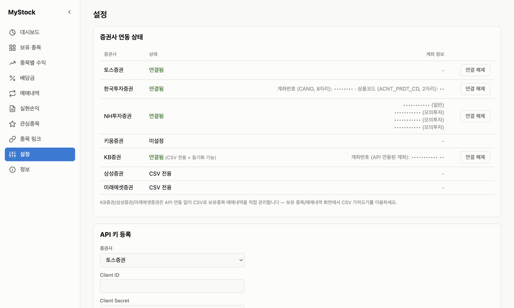

사이드바의 **설정**에서 합니다.

1. **증권사 연동 상태** 표에서 증권사별 연결 여부를 확인합니다. CSV 전용 증권사는 "CSV 전용"으로 보입니다.
2. **API 키 등록**에서 증권사를 고르면 그 증권사에 필요한 입력칸이 자동으로 나타납니다.

   | 증권사 | 입력할 값 |
   |---|---|
   | 토스증권 | Client ID, Client Secret |
   | 한국투자증권 | 앱키, 앱시크릿, 계좌번호(8자리), 상품코드(2자리) |
   | NH투자증권 | 앱키, 앱시크릿 (계좌번호는 계좌 목록 API로 자동으로 찾음) |
   | 키움증권 | 앱키, 시크릿키 (계좌번호는 API가 알려 줌 — 키 하나에 계좌 하나) |
   | KB증권 | appKey, appSecret, API를 연동한 계좌번호 |

3. **저장**을 누르면 끝입니다. 키는 OS 키체인 기반 암호화로 이 컴퓨터에만 저장되고 외부로 보내지 않습니다.
   - NH투자증권은 저장하면 **증권사 연동 상태**의 계좌 정보 칸에 찾은 계좌가 구분과 함께 보입니다(일반·주문대리인·**모의투자**).
   - 키움증권은 키움 포털에 **MyStock을 실행하는 PC의 IP를 등록**해야 조회됩니다. 인터넷 IP가 바뀌면 다시 등록하세요.
     ⚠ 키움 연동은 아직 실제 키움 계좌로 확인하지 못했습니다. 숫자가 키움 앱과 다르면 알려 주세요.
   - NH투자증권은 접근 토큰을 새로 받을 때마다 NH가 **보안 알림**을 보냅니다. 앱은 토큰을 24시간 저장해 재사용하므로 하루 한 번 정도만 옵니다.

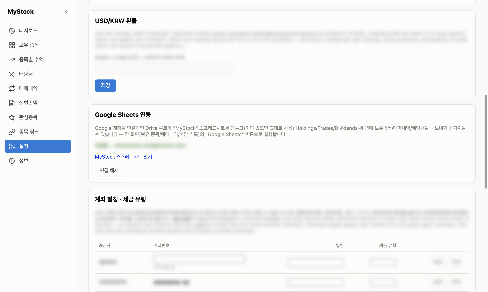

같은 화면 아래쪽에서 다음도 설정합니다.

- **USD/KRW 환율**: 실시간 환율을 못 가져올 때 쓸 환율을 직접 입력합니다. 입력하면 실시간 환율보다 우선합니다.
- **Google Sheets 연동**(실험적 기능 — 사용하려면 등록이 필요): [11장](#11-데이터-백업복원과-google-sheets) 참고.
- **계좌 별칭 · 세금 유형**: 계좌마다 알아보기 쉬운 이름(별칭)과 표시용 계좌번호, 세금 유형(일반/ISA/연금저축/IRP)을 정합니다.
  - 별칭은 모든 화면의 계좌 선택 목록에 쓰입니다.
  - 세금 유형은 [실현손익](#8-실현손익) 계산에 쓰입니다(ISA·연금 계좌는 해외주식 양도세 계산에서 빠짐).
  - 토스증권은 계좌번호가 화면에 "1"처럼 보이므로, 여기서 실제 계좌번호를 표시용으로 입력해 두면 편합니다.
  - NH투자증권 모의투자 계좌는 "(모의투자)"로 표시되고 세금 유형은 "해당 없음"입니다(실현손익 계산에 들어가지 않음). 별칭은 붙일 수 있습니다.

---

## 3. 대시보드

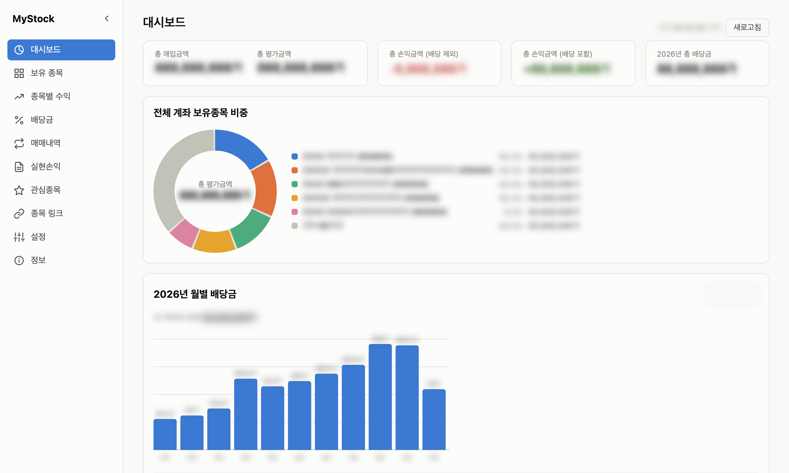

앱을 켜면 처음 보이는 화면으로, **모든 증권사·모든 계좌를 합친** 요약입니다.

- **상단 카드**
  - **총 매입금액 / 총 평가금액**: 한 카드에 나란히 보입니다.
  - **총 손익금액 (배당 제외)**: 평가금액 − 매입금액.
  - **총 손익금액 (배당 포함)**: 위 값에, 지금 보유 중인 종목이 **그 계좌에서** 받은 배당금을 더한 값입니다. 다 팔아버린 종목의 배당은 들어가지 않습니다.
  - **올해 총 배당금**
- **전체 계좌 보유종목 비중**: 평가금액 상위 종목과 나머지("기타")를 도넛으로 보여줍니다. 카드를 누르면 종목별/계좌별 상세가 열립니다.
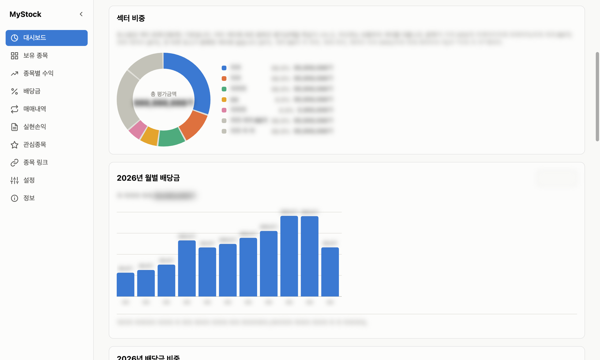

- **섹터 비중**: 보유 종목을 토스증권 섹터 분류(대분류: 반도체, 자동차, 금융 등)로 묶은 도넛입니다(토스 API 키 필요).
  - 여러 섹터에 속한 종목은 평가금액을 똑같이 나누고, **우선주는 보통주의 섹터**를 따릅니다.
  - **ETF도 섹터로 나눕니다.**
    - **국내 ETF**(한국투자증권 API 키 필요)는 구성종목 비중대로 쪼갭니다. 예를 들어 코스피200 ETF라면 반도체 몇 %, 금융 몇 %로 나뉩니다.
      한국투자증권은 비중 상위 30개 종목만 알려 주므로 나머지 비중은 "분류 안 됨"입니다.
    - 구성종목으로 못 나누는 ETF(미국 ETF, 미국 자산을 담은 국내 ETF 등)는 **토스증권이 분류한 섹터**(예: 반도체 ETF → 반도체)에 넣습니다.
    - 어디에도 분류되지 않은 ETF(미국 지수·커버드콜 ETF 등)와 채권·현금 비중은 회색 **"분류 안 됨"** 조각입니다.
  - 분류표는 하루에 한 번 새로 받습니다. 그날 처음 열 때 종목 섹터는 수십 초, **ETF 섹터 분류는 약 2분** 걸리며, 다 받으면 도넛이 저절로 다시 그려집니다.

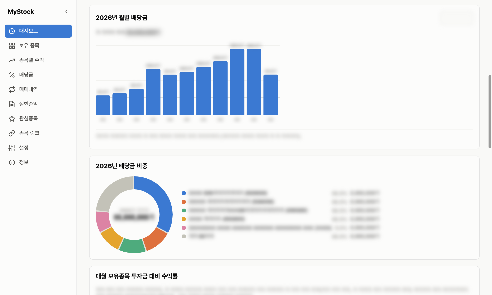

아래로 내리면 연도별 **월별 배당금**, **배당금 비중**, **매월 투자금 대비 수익률**, **월별 총 투자금·총 수입금(평가금액)**, **순자산 추이** 차트가 이어집니다.

- **지수와 비교**: "매월 보유종목 투자금 대비 수익률" 카드 아래 표에서 달마다 내 보유종목 수익률과 **코스피·코스닥** 수익률을 나란히 봅니다(토스 API 키 필요).
  내 보유종목 수익률은 그 달 새로 넣은 투자금을 빼고 계산한 근사치입니다. 토스 API가 미국 지수를 제공하지 않아 국내 지수만 비교합니다.

- 달러 배당금은 배당을 받은 **그 달의 평균 환율**로 원화 환산합니다.
- 이 화면은 자동으로 새로고침하지 않습니다. 오른쪽 위 **새로고침**을 누르세요.

---

## 4. 보유 종목

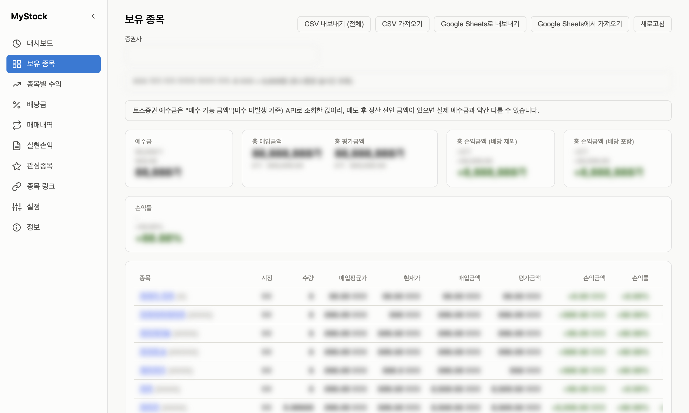

증권사와 계좌를 하나 골라 그 계좌의 보유 종목을 자세히 봅니다.

1. **증권사**를 고르고, **계좌**를 고릅니다. 계좌 목록 맨 아래 **전체 계좌**를 고르면 그 증권사의 모든 계좌를 합쳐서 보고, 표에 "계좌" 열이 생깁니다.
2. 상단 카드: 예수금, 총 매입금액/총 평가금액, **총 손익금액(배당 제외/포함)**, 손익률. 달러 보유분이 있으면 원화·달러·합계(환산)로 나눠 보여줍니다.
   - 한국투자증권·NH투자증권·키움증권은 **국내 주식과 미국 주식**을 함께 보여줍니다(미국 주식은 달러, 달러 예수금 포함). 미국 외 해외 시장은 지원하지 않습니다.
   - **NH투자증권 모의투자 계좌**도 계좌 목록에 "(모의투자)"로 나옵니다. 고르면 가상 자산이라는 안내가 뜨고, 이 화면과 매매내역에서만 보입니다 —
     **전체 계좌**(이름이 "전체 계좌 (모의투자 제외)"로 바뀜)·대시보드·종목별 수익·배당·실현손익 합계와 순자산 기록에는 넣지 않습니다.
3. 종목 표의 열

   | 열 | 뜻 |
   |---|---|
   | 매입평균가 / 현재가 | 종목의 통화(원 또는 USD) 기준 |
   | 매입금액 / 평가금액 / 손익금액 / 손익률 | 증권사가 알려준 값 |
   | **배당 포함 손익금액** | 손익금액 + **이 계좌에서 이 종목으로** 받은 배당금. 다른 계좌의 같은 종목 배당은 섞지 않습니다. 마우스를 올리면 평가손익과 배당금이 나눠 보입니다. |
   | 비중 | 이 계좌(또는 전체 계좌) 안에서의 평가금액 비중 |

- 토스·KIS·NH·키움 계좌는 **1분마다 자동 새로고침**되고, 바로 갱신하려면 **새로고침**(10초에 한 번)을 누릅니다.
  - 화면 위에 **국내·미국 장 상태**(예: "국내 정규장 · 미국 데이마켓", "국내 휴장")가 보입니다. **두 시장이 모두 닫혀 있으면 자동 새로고침을 쉽니다**(시세가 안 움직여서). 수동 새로고침은 언제든 됩니다.
- 종목명 옆 빨간 배지는 **매수 유의사항**입니다: 정리매매, 단기과열, 투자경고, 투자위험, VI 발동, 신주인수권(토스 API 키 필요). 마우스를 올리면 기간이 보입니다.
- KB증권의 API 연동 계좌는 화면을 열 때 백그라운드로 최신화됩니다.
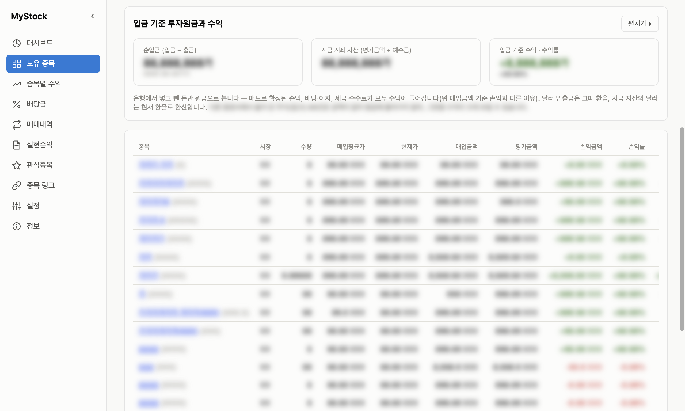

- **입금 기준 투자원금과 수익 (토스증권·NH투자증권·키움증권)**: 표 위 카드에서 은행에서 넣고 뺀 돈(순입금)과 지금 계좌 자산(평가금액 + 예수금)을
  비교한 **실제 수익·수익률**을 봅니다. 매입금액 기준 손익과 달리 매도로 확정된 손익, 배당·이자, 세금·수수료가 모두 들어갑니다.
  펼치면 연도별 입금·출금이 보입니다.
  - 환전은 계좌 안에서 통화만 바뀌는 것이라 원금에 넣지 않고, ETF 분배금·외화세금환급처럼 종목이 붙은 입금도 넣지 않습니다.
  - **다른 증권사에서 옮겨 온 주식(입고)은 금액이 없어 원금에 들어가지 않습니다** — 입고가 있으면 카드가 건수를 알려 주고, 수익이 그만큼 크게 보일 수 있습니다.
  - NH투자증권은 입출금내역의 입금·출금을 원금으로 셉니다(배당·이자·세금 입출금은 제외, 원화만). 모의투자 계좌에는 이 카드가 없습니다.
  - 한국투자증권은 입출금 내역 API가 없어 이 카드가 없습니다.
- 종목명을 누르면 [종목 링크](#10-종목-링크)에 정한 웹페이지(기본: 토스증권 종목 페이지)가 브라우저로 열립니다.

### CSV로 보유 종목 관리 (삼성·미래에셋·KB 등)
- **CSV 내보내기 (전체)**: 저장된 모든 증권사·계좌의 보유 종목을 한 파일로 받습니다. 이 파일을 고쳐서 그대로 다시 가져올 수 있습니다.
- **CSV 가져오기**: 파일에 나온 계좌마다 **기존 보유 종목을 지우고 파일 내용으로 교체**합니다(덮어쓰기). 같은 파일을 여러 번 가져와도 쌓이지 않습니다.
- 주요 컬럼: `broker, accountId, symbol, quantity, averagePurchasePrice, lastPrice, purchaseAmount, marketValue, profitLossAmount, profitLossRate, commission, tax, currency, market` (+ 선택 `memo`)
  - `memo`는 IRP처럼 같은 종목을 "개인납입/회사납입"으로 나눠 적을 때 씁니다.
  - 종목명은 적지 않아도 종목코드로 자동 조회됩니다.
- API로 실시간 연동되는 계좌의 행은 가져오기에서 건너뜁니다.

---

## 5. 종목별 수익

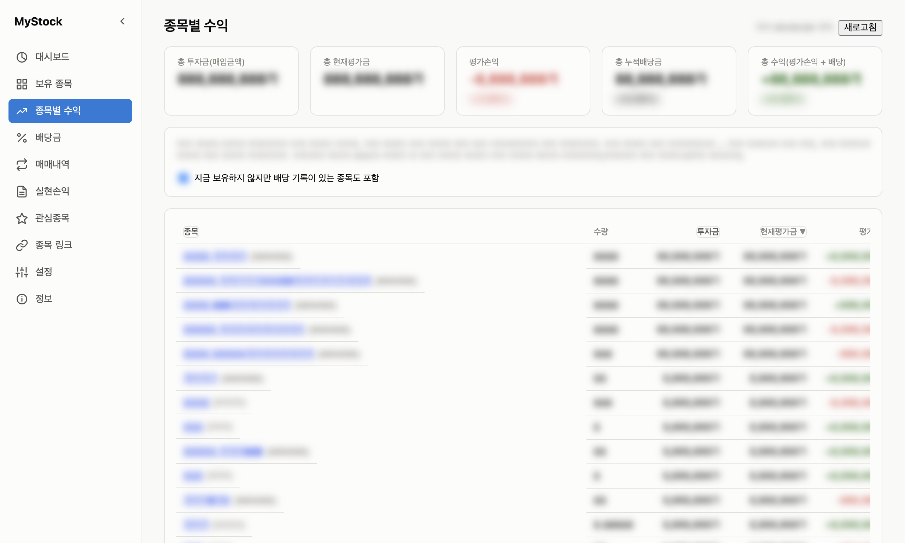

**모든 증권사·계좌를 종목 단위로 합쳐서**, 종목마다 "얼마를 넣었고, 지금 얼마이고, 배당을 얼마나 받았나"를 한 줄로 봅니다.

- 열: 수량, 투자금, 현재평가금, 평가손익, 손익률, 누적배당금, 배당수익률, **총 수익(평가손익 + 배당)**, 총 수익률
- 금액 열 제목을 누르면 그 기준으로 정렬됩니다.
- **지금 보유하지 않지만 배당 기록이 있는 종목도 포함**: 다 팔았지만 배당을 받았던 종목까지 보여줄지 정합니다.
- 보유 종목 화면의 "배당 포함 손익금액"은 계좌별, 이 화면은 **종목 전체** 기준이라는 점이 다릅니다.

---

## 6. 배당금

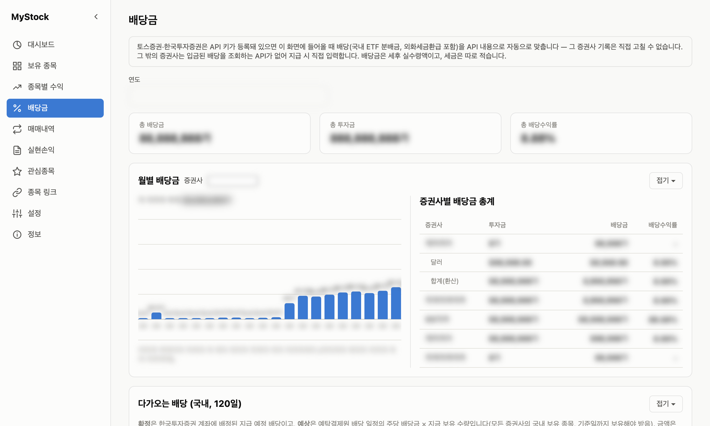

배당금은 **세후 실수령액**으로 기록하고, 원천징수 **세금**은 따로 적습니다(세전 = 배당금 + 세금). 모든 화면의 배당 합계는 세후 기준입니다.

- **토스증권·한국투자증권·NH투자증권·키움증권 (API 자동 동기화)**: API 키를 등록해 두면 이 화면에 들어올 때마다 그 계좌의 배당 기록을
  **API 내용으로 맞춥니다.** 목록 위 **배당 동기화** 버튼으로 바로 다시 맞출 수도 있습니다.
  - 증권사 API가 원천이라 이 네 증권사의 배당은 **직접 추가·수정·삭제할 수 없고**(목록에 "API 연동"으로 표시),
    CSV·Google Sheets 가져오기에서도 건너뜁니다. 직접 붙인 메모는 동기화 때 사라집니다.
    단, **한국투자증권의 달러 배당**(미국 주식)은 API가 주지 않으므로 직접 기록하고 고칠 수 있습니다(아래).
  - **토스증권**: 일반 배당, **국내 ETF 분배금**, **외화세금환급**(미국 ETF 배당에서 뗀 세금을 이듬해 돌려받은 돈, 메모 "외화세금환급").
    날짜는 토스증권 앱에 보이는 입금일입니다. 미국 배당은 현지 세금이 이미 빠진 금액이라 세금 칸이 0입니다.
  - **한국투자증권**: 국내 배당과 ETF 분배금. 날짜는 현금 지급일이고, **지급 예정인 배당은 지급일이 지나야 들어옵니다.**
    해외(미국 주식) 배당은 계좌 기준으로 조회하는 API가 없어 가져오지 않습니다 — **달러 배당은 직접 기록**합니다(배당 기록 추가에서
    증권사 "한국투자증권 (달러 배당만)"을 고르면 통화가 달러로 고정됩니다). 직접 적은 달러 배당은 동기화가 지우지 않습니다.
  - **NH투자증권**: 국내 배당·ETF 분배금(종합거래내역의 입금)과 **미국 주식 배당(달러, 해외 거래내역의 입금)**을 모두 가져옵니다.
    실전 계좌만 동기화하고 모의투자 계좌는 넣지 않습니다. ⚠ 실제 배당 데이터로는 아직 검증 전이라, 금액이 증권사 앱과 다르면 알려 주세요.
  - **키움증권**: 거래내역의 입금 중 배당·분배금(원화)과 미국 주식 배당(달러)을 가져옵니다. ⚠ 실제 키움 데이터로 확인 전입니다.
  - 우선주 배당은 증권사가 보통주 코드로 알려 주는데, 우선주를 사고판 기록이 있으면 우선주 코드로 저장합니다.
- **KB·삼성·미래에셋**: 입금된 배당을 조회할 수 있는 API가 없어서, 받은 배당을 **직접 기록**합니다(세금은 선택).

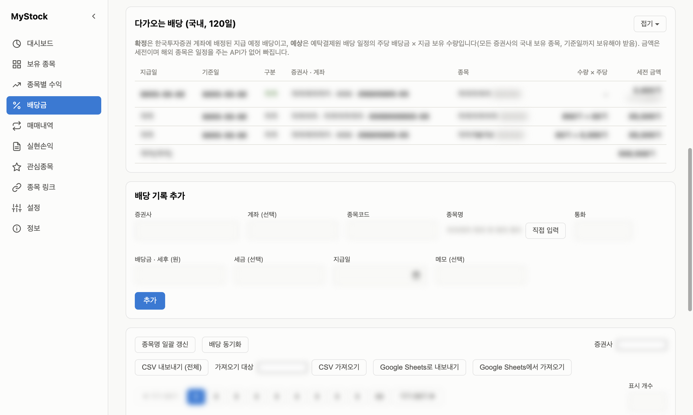

- **다가오는 배당 (한국투자증권 API 키 필요)**: 국내 배당을 보여줍니다. 확정은 앞으로 120일, 예상·추정은 **이번 달에 지급될 것만** 보여 줍니다.
  - **확정**: 한국투자증권 계좌에 배정된 지급 예정 배당(세금까지 정확).
  - **예상**: 예탁결제원 배당 일정의 주당 배당금 × 지금 보유 수량 — 토스·KB 등 **다른 증권사의 국내 보유 종목도** 포함합니다.
    기준일까지 보유해야 받고, 지급일이 아직 안 정해졌으면 "미정"입니다.
  - **추정**: 매달·분기처럼 정기적으로 배당하는 종목은 예탁원에 다음 일정이 올라오기 전에도(매달 분배 ETF는 기준일 며칠 전에야 올라옵니다)
    지난 1년 일정으로 다음 배당을 짐작해 보여 줍니다. 주당 금액은 최근 12회의 **중간값**이고(가끔 튀는 달의 영향을 줄이려고),
    기준일이 주말·휴일이면 직전 영업일로, 지급일은 지난 일정처럼 기준일 뒤 몇 영업일로 계산합니다(실제 공시와 다를 수 있음). 예탁원에 일정이 올라오면 그 값(예상)으로 바뀝니다.
  - 금액은 세전이고, 해외 종목은 일정을 알려 주는 API가 없어 빠집니다.
- **연도**를 고르면 그 해의 총 배당금, 총 투자금, 배당수익률과 월별 그래프, 증권사별 총계가 보입니다.
- 달러 배당은 **받은 달의 평균 환율**로 원화 환산합니다.

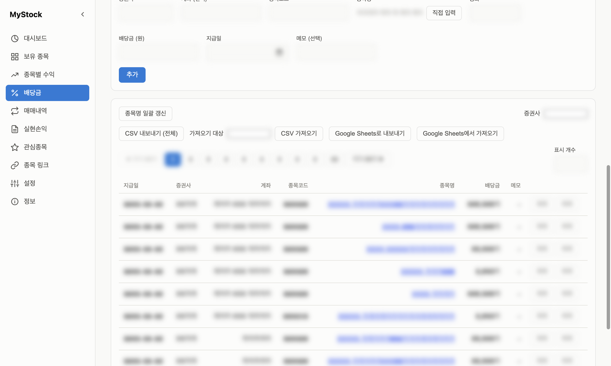

### 배당 기록 추가
1. 증권사를 고르고, **계좌(선택)** 를 적습니다. 계좌를 적어 두어야 보유 종목 화면의 "배당 포함 손익금액"에 그 계좌 배당으로 들어갑니다.
   - 계좌를 비우면, 그 증권사 계좌가 하나뿐일 때만 그 계좌 배당으로 칩니다.
2. **종목코드**를 입력하면 종목명이 자동으로 채워집니다(못 찾으면 직접 입력).
3. 통화(KRW/USD), 배당금, 지급일, 메모를 적고 추가합니다.

- 목록의 각 행은 **수정**으로 그 자리에서 고칠 수 있습니다.
- **종목명 일괄 갱신**: 저장된 기록의 종목명을 최신 이름으로 다시 채웁니다.
- **CSV 내보내기/가져오기**: 컬럼 `broker, accountId, symbol, currency, amount, paidDate, memo`(+ 선택 `tax`). `amount`는 세후입니다. 토스증권·NH투자증권·키움증권 행과 한국투자증권의 원화 행은 가져오지 않습니다(한국투자증권 달러 행은 가져옴).

---

## 7. 매매내역

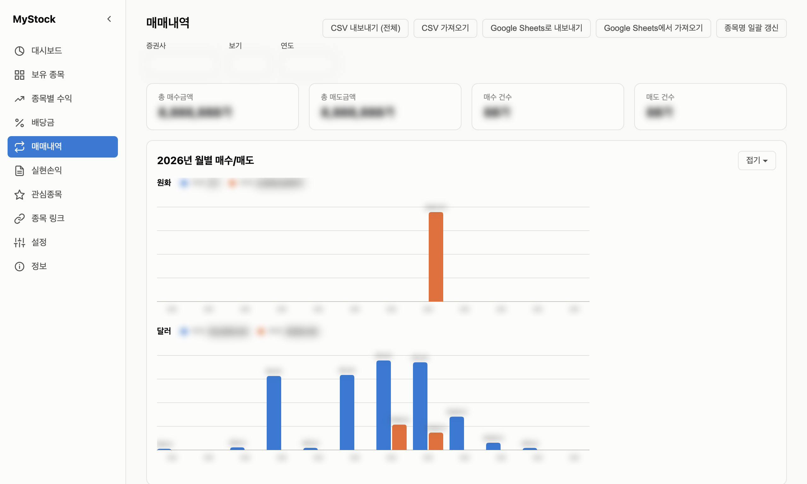

- 위쪽에서 **증권사**(또는 **전체**), 계좌, 보기(연간/월간), 연도를 고릅니다.
- 한국투자증권은 국내 체결과 **미국 주식 체결(달러, 현지 주문일 기준)**을 함께 가져옵니다.
- NH투자증권도 국내(종합거래내역의 매매)와 미국 주식(해외 거래내역의 매수·매도)을 함께 가져옵니다. 모의투자 계좌를 고르면 그 계좌 체결을 보여 주지만
  "전체" 보기·실현손익에는 넣지 않습니다.
- 상단 카드: 총 매수금액, 총 매도금액, 매수 건수, 매도 건수
- **월별 매수/매도** 그래프는 원화와 달러를 섞지 않고 위아래로 따로 그립니다.

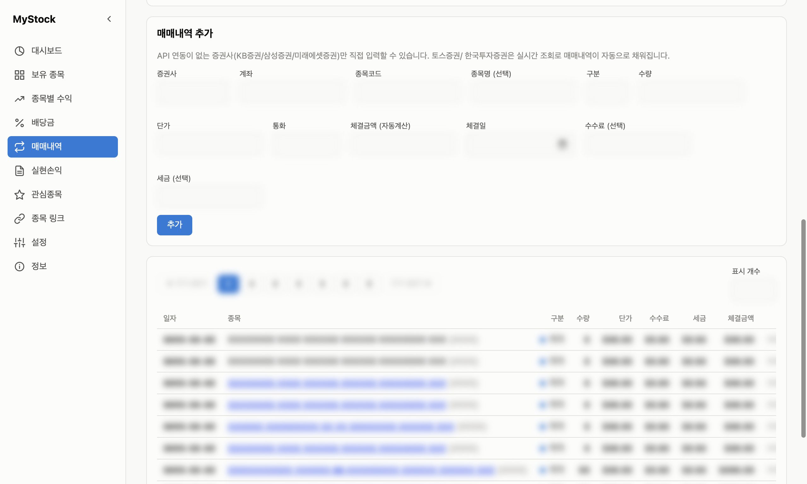

- 목록의 "체결금액"은 수량×단가에 **수수료와 세금을 더한** 금액입니다(마우스를 올리면 내역이 보임).
- **매매내역 추가**(CSV 전용 증권사만): 수량과 단가를 넣으면 체결금액이 자동 계산됩니다.
- CSV 전용 증권사 행은 **수정/삭제**할 수 있고, 토스·KIS·NH·키움 행은 실시간 연동이라 고칠 수 없습니다.
- **CSV 가져오기**: 컬럼 `broker, accountId, symbol, name, side, quantity, price, amount, currency, executedAt, commission, tax` (+ 선택 `id` — 같은 거래를 다시 가져올 때 중복을 막음)
- "전체" 보기는 이 컴퓨터에 저장된 매매내역 기준이라, 토스·KIS·NH·키움은 한 번이라도 조회한 연도만 나타납니다.

---

## 8. 실현손익

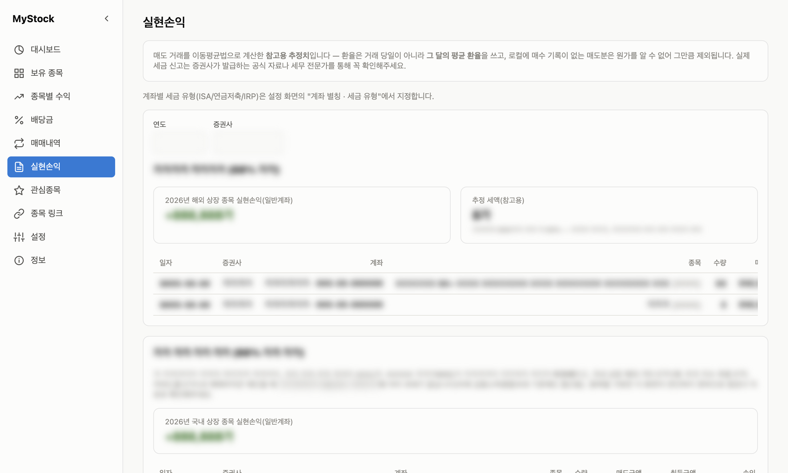

매도한 거래의 실현손익을 **이동평균법**으로 계산합니다. **참고용 추정치**이며, 실제 세금 신고는 증권사가 발급하는 공식 자료로 확인하세요.

- **해외 상장 종목 실현손익(일반계좌)** 과 **추정 세액**(기본공제 250만 원 후 22%)을 보여줍니다.
- 환율은 거래 당일이 아니라 **그 달의 평균 환율**을 씁니다.
- 국내 상장 종목 매도와 ISA·연금저축·IRP 계좌 매도는 22% 계산에서 빼고 따로 보여줍니다. 계좌의 세금 유형은 [설정](#2-증권사-연결하기-설정)에서 정합니다.
- 배당소득은 양도소득과 따로 보여주며, 금융소득종합과세 기준(연 2,000만 원) 대비 비율을 함께 표시합니다.
- 매수 기록이 없는 매도분은 원가를 알 수 없어 계산에서 빠집니다.
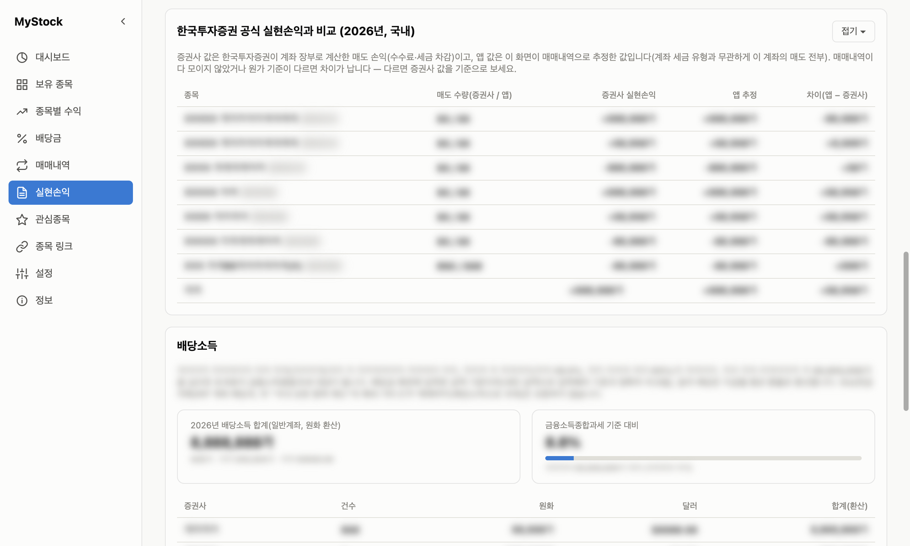

- **한국투자증권 공식 실현손익과 비교** (한국투자증권 API 키 필요): 그 해 한국투자증권 계좌의 매도를 증권사가
  계산한 실현손익(수수료·세금 차감)과 앱 추정치를 종목별로 나란히 보여줍니다. 차이가 크면 매매내역이 덜 모였거나
  원가 기준이 다른 것이니 증권사 값을 기준으로 보세요.
  - 국내 매도 카드는 항상, **해외(미국) 매도 카드**는 그 해 한국투자증권 달러 매도가 있을 때 보입니다(증권사 값도 원화 환산).
- **NH투자증권 공식 실현손익과 비교** (NH API 키 필요): 같은 카드로 NH 실전 계좌들의 **국내** 매도를 비교합니다. NH는 종목별 기간 합계로
  알려 줍니다. 해외(미국) 매도는 NH API가 종목별 값을 주지 않아 비교 카드가 없습니다.
- **키움증권 공식 실현손익과 비교** (키움 API 키 필요): 국내 매도(매도 건별)와, 그 해 키움 달러 매도가 있으면 미국 매도(원화 환산)도 비교합니다.

---

## 9. 관심종목

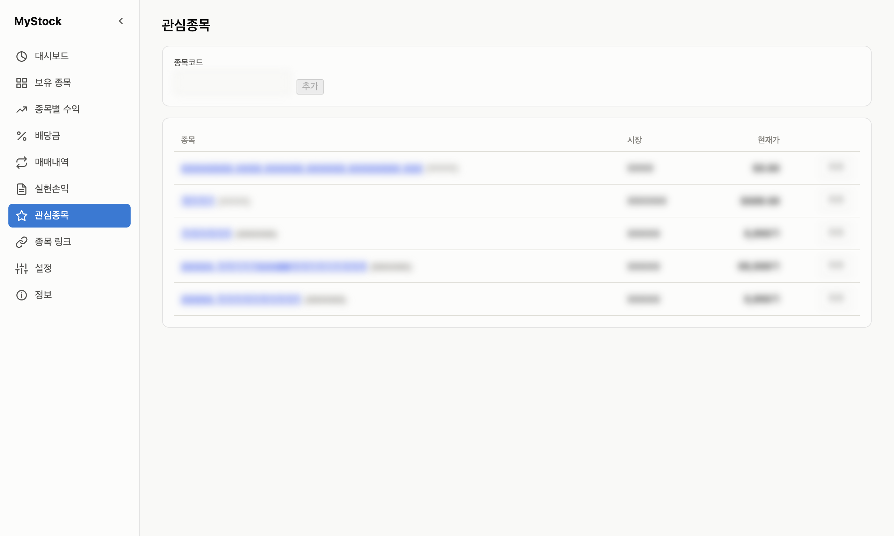

보유하지 않은 종목의 현재가를 지켜봅니다.

1. **종목코드**를 입력하고 **추가**를 누릅니다(종목명은 자동으로 채워짐).
2. 목록에서 종목 행을 누르면 아래에 상세(현재가, 시장, 통화)와 **월별 종가 차트**가 열립니다. 차트 기간은 최근 12개월 / 전체 기간 / 연도별로 바꿀 수 있습니다.
3. 오른쪽 **삭제**로 목록에서 뺍니다.

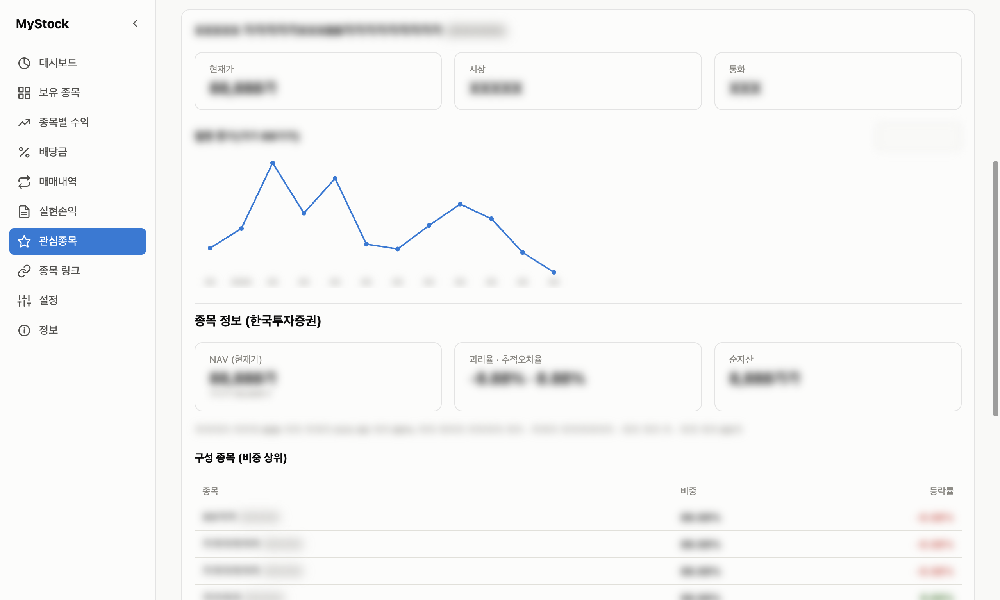

**국내 종목 정보 (한국투자증권 API 키 필요)** — 국내 종목의 상세 아래에 **종목 정보** 칸이 붙습니다.
- **주식**: 연간 재무비율(매출·영업이익·순이익 증가율, ROE, EPS, BPS, 부채비율)과 최근 6개월 **증권사 투자의견·목표가**.
  가장 최근 줄은 결산 전 누적 값일 수 있습니다. 투자의견은 증권사 리포트를 옮긴 것이며 투자 권유가 아닙니다.
- **ETF**: **NAV**, 괴리율, 추적오차율, 순자산, 기초지수·운용사·분배 주기와 **구성 종목**(비중 상위 30개 — 한국투자증권이 그만큼만 줍니다).
- 둘 다 최근 **뉴스·공시 제목**을 보여줍니다(본문은 증권사 앱에서 확인). 해외 종목은 대상이 아닙니다.

종목명 옆 빨간 배지는 보유 종목 화면과 같은 **매수 유의사항**입니다.

---

## 10. 종목 링크

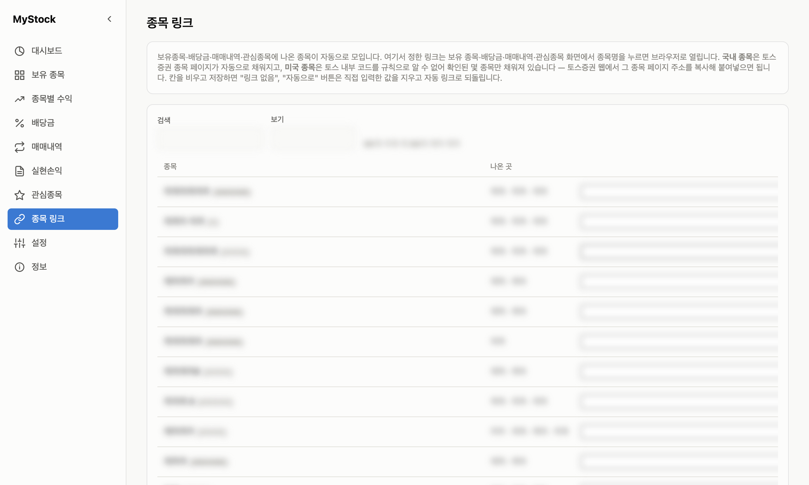

다른 화면에서 종목명을 눌렀을 때 열릴 웹페이지를 정합니다. 보유 종목·배당금·매매내역·관심종목에 나온 종목이 자동으로 모입니다.

- 칸을 비워 두면 **자동 링크**(토스증권 웹 종목 페이지)를 씁니다. 국내 종목은 자동으로 만들어지고, 미국 종목은 확인된 일부만 자동입니다.
- 원하는 주소를 붙여넣고 저장하면 그 주소로 열립니다.
- 빈 값으로 저장하면 "링크 없음", **자동으로** 버튼은 입력값을 지우고 자동 링크로 되돌립니다.

---

## 11. 데이터 백업·복원과 Google Sheets

### 데이터 백업/복원 (설정 화면 맨 아래 "데이터 백업/복원" 카드)

MyStock의 데이터는 이 컴퓨터에만 저장됩니다. PC를 바꾸거나 다시 설치하기 전에, 또는 CSV·Google Sheets로 데이터를
크게 바꾸기 전에 백업을 받아 두세요.

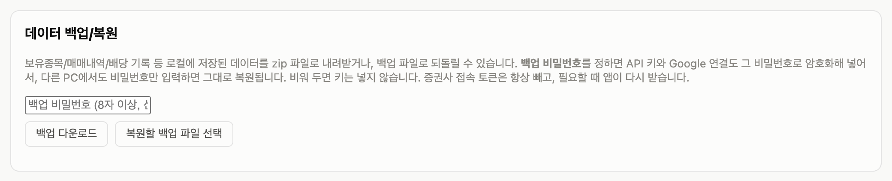

#### 백업에 들어가는 것과 빠지는 것

| 항목 | 백업 비밀번호 없이 | 백업 비밀번호를 정하면 |
|---|---|---|
| 보유 종목·매매내역·배당 기록, 계좌 별칭·세금 유형, 관심종목, 종목 링크, 자산 스냅샷, 설정(수동 환율 등), 종목명 캐시 | ✅ 들어감 | ✅ 들어감 |
| 증권사 API 키, Google 계정 연결 | ❌ 빠짐 | ✅ 그 비밀번호로 암호화해 들어감 |
| 증권사 접속 토큰(한국투자증권·KB증권) | ❌ 항상 빠짐 | ❌ 항상 빠짐 |

- API 키는 평소 이 PC의 OS 키체인으로 잠겨 있어 다른 PC에서는 열 수 없습니다. 백업 비밀번호를 정하면 키를 그 비밀번호로
  다시 암호화(scrypt + AES-256-GCM)해 넣으므로, **다른 PC에서도 비밀번호만 알면 키까지 복원**됩니다.
- 접속 토큰은 하루 안팎이면 만료되고 필요할 때 앱이 다시 받기 때문에 넣지 않습니다.

#### 백업 받기

1. **설정**을 열고 맨 아래 **데이터 백업/복원** 카드로 갑니다.
2. API 키도 함께 옮기려면 **백업 비밀번호**(8자 이상)를 입력하고, 나타나는 **비밀번호 확인** 칸에 한 번 더 입력합니다.
   데이터만 백업하려면 비워 둡니다.
3. **백업 다운로드**를 누르면 `mystock-backup-YYYY-MM-DD.zip` 파일이 내려받아집니다.

> ⚠ 백업 비밀번호는 어디에도 저장되지 않습니다. **잊으면 그 백업의 API 키는 복원할 수 없습니다.** 데이터(보유 종목 등)도
> 비밀번호를 입력해야 복원되므로, 비밀번호를 잊었다면 비밀번호 없이 새 백업을 다시 받아 두세요.
> 비밀번호로 만든 백업 파일도 다른 사람에게 보내지 마세요. 보유 종목·매매내역·계좌 정보는 암호화되지 않은 채 들어 있습니다.

#### 복원하기

1. **복원할 백업 파일 선택**을 누르고 `mystock-backup-….zip` 파일을 고릅니다. 파일을 고르는 것만으로는 복원되지 않습니다.
2. "현재 저장된 모든 데이터가 이 백업 파일 내용으로 완전히 대체됩니다"라는 확인 상자가 나타납니다.
   백업할 때 비밀번호를 정했다면 **백업 비밀번호**를 입력하고, 아니면 비워 둡니다.
3. **정말 복원하기**를 누릅니다. 그만두려면 **취소**를 누릅니다.
4. 완료 메시지를 확인합니다.
   - 설치본은 **잠시 후 앱이 자동으로 다시 시작**됩니다. 소스에서 실행한 경우는 앱을 직접 다시 시작하세요.

복원할 때 알아둘 것:

- 지금 데이터가 백업 시점의 데이터로 **덮어써집니다.** 복원 전에 지금 상태도 백업해 두면 되돌릴 수 있습니다.
- **비밀번호로 만든 백업을 복원하면** API 키와 Google 연결도 백업 내용으로 바뀝니다. 백업에 없는 증권사의 키는 지워지고,
  이전 키로 받아 둔 접속 토큰도 지워져 새 키로 다시 받습니다.
- **비밀번호 없이 만든 백업을 복원하면** 데이터만 바뀌고, 지금 PC에 등록된 API 키와 Google 연결은 그대로 남습니다.
  새 PC라면 복원 후 **설정 → API 키 등록**에서 키를 다시 입력하세요.
- 비밀번호가 틀리면 "백업 비밀번호가 올바르지 않습니다."가 뜨고, **아무것도 바뀌지 않습니다.** 비밀번호로 만든 백업인데 칸을 비워 두면
  비밀번호를 입력하라는 안내가 뜹니다.
- 키링이 없는 Linux에서는 키를 안전하게 저장할 수 없어서, 데이터만 복원하고 API 키와 Google 연결은 복원하지 않습니다.

#### PC를 옮길 때

1. 쓰던 PC에서 **백업 비밀번호를 정해** 백업을 받습니다.
2. 새 PC에 MyStock을 설치하고 한 번 실행합니다([서명하지 않은 앱 처음 실행하기](#서명하지-않은-앱-처음-실행하기) 참고).
3. **설정 → 데이터 백업/복원**에서 백업 파일과 비밀번호로 복원합니다. 앱이 다시 시작되면 API 키와 데이터가 그대로 보입니다.
4. macOS는 다시 시작한 뒤 키체인 접근을 물을 수 있습니다. **항상 허용**을 누르세요.

### Google Sheets 연동

> 🧪 **실험적 기능(Experimental)입니다.** Google Sheets 가져오기/내보내기는 아직 일반 사용자에게 열려 있지
> 않아서, 그냥 설치한 앱에서는 Google 계정 연결이 되지 않습니다. 사용하려면 아래 둘 중 하나가 필요합니다.
>
> - **Maintainer에게 이메일로 등록을 요청**: 사용할 Google 계정(이메일 주소)을 [ultracat.lcw@gmail.com](mailto:ultracat.lcw@gmail.com)으로
>   보내 테스트 사용자로 등록받은 뒤 사용합니다.
> - **저장소를 fork해서 직접 관리**: 본인의 Google Cloud 프로젝트에서 OAuth 클라이언트(데스크톱 앱 유형)를
>   만들고, 그 Client ID/Secret을 `backend/src/google/clientConfig.ts`(템플릿: `clientConfig.example.ts`)에 넣거나
>   fork한 저장소의 GitHub Secrets(`GOOGLE_CLIENT_ID`, `GOOGLE_CLIENT_SECRET`)에 등록해 직접 빌드합니다.
>
> 등록 없이도 같은 데이터를 **CSV 내보내기/가져오기**로 옮길 수 있습니다.

등록이 끝났거나 직접 빌드한 앱이라면:

1. 설정의 **Google Sheets 연동**에서 **Google 계정 연결**을 누르면 브라우저에서 로그인 창이 열립니다.
2. 연결되면 Google Drive에 "MyStock" 스프레드시트가 만들어지고, **MyStock 스프레드시트 열기** 링크가 보입니다.
3. 보유 종목·매매내역·배당금 화면의 **Google Sheets로 내보내기 / Google Sheets에서 가져오기** 버튼을 씁니다.

> ⚠ **Google Sheets에서 가져오기는 CSV 가져오기와 다릅니다.** 직접 관리하는(CSV 전용) 계좌의 데이터를
> 시트 내용으로 **완전히 교체**하고, 잘못된 행이 하나라도 있으면 전부 취소됩니다.

---

## 12. 편의 기능과 문제 해결

### 화면 확대/축소
- 트랙패드 핀치, **⌘(Ctrl) + 휠**, **⌘(Ctrl) + `+` / `-` / `0`** 으로 내용 영역을 확대/축소합니다(`0`은 100%로).
- 사이드바는 크기가 그대로이고, 확대하면 내용이 화면 밖으로 넘쳐 스크롤됩니다.
- 사이드바 위쪽 **〈** 버튼으로 사이드바를 아이콘만 남기고 접을 수 있습니다.

### 앱이 실행되지 않을 때 (설치 직후)

| 증상 | 해결 |
|---|---|
| macOS: "'MyStock'을(를) 열지 않음" | 완료 → 시스템 설정 → 개인정보 보호 및 보안 → **그래도 열기** ([자세히](#macos)) |
| macOS: "손상되었기 때문에 열 수 없습니다" | 터미널에서 `xattr -dr com.apple.quarantine "/Applications/MyStock.app"` |
| Windows: "Windows의 PC 보호" | **추가 정보 → 실행**, 버튼이 없으면 파일 속성의 **차단 해제** ([자세히](#windows)) |
| Linux: AppImage가 실행되지 않음 | `chmod +x`, FUSE 오류면 `libfuse2`/`libfuse2t64` 설치 ([자세히](#linux)) |
| 증권사 조회가 갑자기 실패함(새 버전 설치 후) | macOS 키체인 접근을 거부했을 수 있습니다. **설정 → API 키 등록**에서 키를 다시 저장하세요. |

### 증권사 조회가 안 될 때 (IP 등록·보안 알림)

증권사마다 API를 쓸 수 있는 PC를 IP로 제한하거나, 접속할 때 알림을 보냅니다. 화면에 뜨는 오류 문구에 증권사 오류 코드가 함께 나옵니다.

| 증권사 | 증상 | 해결 |
|---|---|---|
| 토스증권 | 보유 종목·계좌 조회가 실패함(허용되지 않은 IP) | 토스증권 WTS의 **설정 > Open API > 허용 IP 관리**에 지금 PC의 공인 IP를 등록합니다. 집 인터넷처럼 IP가 바뀌는 환경이면 바뀔 때마다 다시 등록하세요. |
| 키움증권 | 조회가 실패하고 오류 코드 **8010**(토큰을 받은 IP와 다름)이나 IP 관련 문구가 보임 | 키움 OpenAPI 포털의 **계좌 APP Key 관리**에서 지금 PC의 IP를 추가합니다(여러 개 등록 가능). IP가 바뀌면 앱이 토큰을 자동으로 다시 받지만, 포털에 없는 IP면 계속 실패합니다. 오류 코드 **8001·8002**는 앱키·시크릿키가 틀린 경우라 설정에서 다시 저장하세요. ⚠ 키움 연동은 아직 실제 계좌로 확인 전이라, 위에 없는 오류가 나면 알려 주세요. |
| NH투자증권 | NH에서 **보안 알림**(접근 토큰 발급 알림)이 옴 | 정상입니다. NH는 접근 토큰을 새로 받을 때마다 알림을 보냅니다. MyStock은 토큰을 24시간 저장해 재사용하므로 보통 하루 한 번 정도 옵니다. 앱키를 바꾸면 새 토큰을 받으면서 한 번 더 옵니다. 내가 앱을 쓰지 않았는데 알림이 오면 NH 포털에서 앱키를 재발급하세요. |

> 지금 PC의 공인 IP는 브라우저에서 "내 IP"를 검색하면 확인할 수 있습니다.

### "환율 미적용"이 보일 때
실시간 환율을 가져오지 못해 달러 금액을 원화로 합치지 못한 것입니다. **설정 → USD/KRW 환율**에 환율을 직접 입력하세요.

### 섹터 비중에 "분류 안 됨"이 클 때
미국 지수·커버드콜 ETF처럼 토스증권 섹터 분류에 없는 ETF와, 국내 ETF의 비중 상위 30개 밖 종목·채권·현금이 여기에 들어갑니다.
국내 ETF를 구성종목으로 나누려면 한국투자증권 API 키가 필요합니다. 그날 처음 열었다면 ETF 섹터 분류를 받는 약 2분 동안은 더 크게 보일 수 있습니다.

### 배당 포함 손익에 배당이 안 들어갈 때
배당 기록의 **계좌**가 비어 있고 그 증권사에 계좌가 여러 개면 어느 계좌 배당인지 알 수 없어 더하지 않습니다. 배당금 화면에서 그 기록의 계좌를 채워 주세요. 토스증권은 설정의 계좌 별칭에 **표시용 계좌번호**를 입력해 두면 그 번호로 적은 배당도 인식합니다.

### 앱 정보

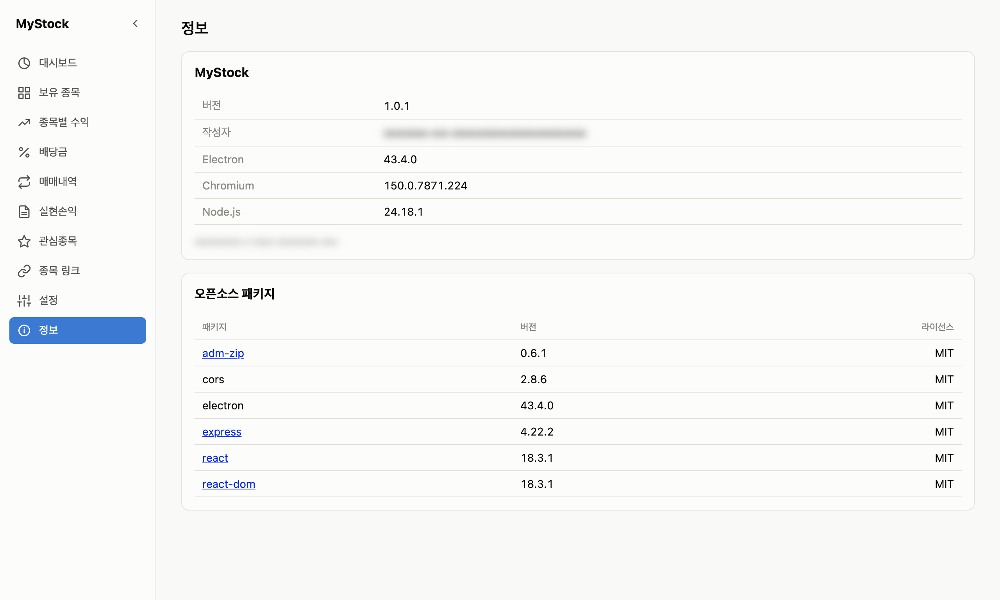

사이드바 맨 아래 **정보**에서 앱 버전, Electron/Chromium/Node 버전, 사용 중인 오픈소스 패키지와 라이선스를 볼 수 있습니다.

---

## 부록. 증권사 API 키 발급 안내

API 키 발급 절차는 증권사가 수시로 바꿀 수 있어서, 이 매뉴얼에는 **어디를 보면 되는지**만 적습니다.
발급받은 값은 [설정 → API 키 등록](#2-증권사-연결하기-설정)에 입력합니다.
삼성증권·미래에셋증권처럼 API 연동이 없는 증권사는 키 없이 CSV로 씁니다.

| 증권사 | 어디서 발급하나 | MyStock에 넣을 값 | 알아둘 것 |
|---|---|---|---|
| **토스증권** | 토스증권 WTS(웹) 로그인 → **설정 > Open API** | Client ID, Client Secret | 같은 화면 아래 **허용 IP 관리**에 MyStock을 실행하는 PC의 공인 IP를 등록해야 합니다. 등록하지 않은 IP에서는 조회가 막힙니다. 집 인터넷처럼 IP가 바뀌는 환경이면 바뀔 때마다 다시 등록하세요. |
| **한국투자증권** | [KIS Developers](https://apiportal.koreainvestment.com) 위쪽 **API신청**(한국투자증권 홈페이지·앱의 Open API 서비스 신청) | 앱키, 앱시크릿, 계좌번호 앞 8자리, 상품코드 뒤 2자리 | 계좌 개설과 ID 연결이 먼저 필요합니다. MyStock은 **실전투자용** 앱키만 지원합니다(모의투자 미지원). 상품코드는 종합계좌면 보통 `01`입니다. |
| **NH투자증권(나무)** | [NHPLUG 포털](https://www.nhplug.com)의 API 가이드 화면 → **API 사용신청**(나무 MTS 앱 QR 로그인 또는 홈페이지 공동인증서 로그인), 신청 후 **시크릿조회**로 앱키·시크릿 확인 | 앱키, 앱시크릿 | 계좌번호는 넣지 않습니다(계좌 목록을 API로 찾음). 모의투자 계좌도 함께 보입니다. 토큰을 새로 받을 때마다 NH가 보안 알림을 보냅니다(앱은 24시간 재사용). |
| **키움증권** | [키움증권 OpenAPI 포털](https://openapi.kiwoom.com) 로그인 → **API 사용신청** → 앱 등록 후 App Key·Secret Key 확인, 같은 포털의 계좌 APP Key 관리에서 **사용할 PC의 IP 등록**(최대 10개) | 앱키, 시크릿키 | 키가 **계좌 하나**에 묶입니다. 실전투자와 모의투자 키가 따로 발급되는데, MyStock은 **실전투자 키만** 지원합니다. IP가 바뀌면 포털에서 새 IP를 추가하세요. ⚠ MyStock의 키움 연동은 아직 실제 계좌로 확인하지 못했습니다. |
| **KB증권** | [KB증권 홈페이지](https://www.kbsec.com)의 Open API 메뉴에서 본인 인증 후 신청(2026년 개인 고객 대상 오픈베타) | appKey, appSecret, API를 연동한 계좌번호 | 키가 **계좌 하나에 묶여** 발급됩니다. 그 계좌만 자동 동기화되고 나머지 KB 계좌는 CSV로 관리합니다. IRP·연금저축 계좌는 API 연동이 안 되고, 종합계좌도 새로 만든 계좌만 연동되는 것으로 확인했습니다. |

공식 안내:
- 토스증권: [토스증권 Open API 가이드](https://developers.tossinvest.com/docs) — "시작하기"에 클라이언트 등록과 허용 IP 등록 순서가 있습니다.
- 한국투자증권: [KIS Developers 서비스 이용안내](https://apiportal.koreainvestment.com/about-howto), [공식 GitHub 저장소](https://github.com/koreainvestment/open-trading-api)
- NH투자증권: [NHPLUG 포털](https://www.nhplug.com)(API 가이드·테스트베드 오류코드), [공식 GitHub(PLUG-OpenAPI)](https://github.com/PLUG-OpenAPI)
- 키움증권: [키움 REST API 가이드](https://openapi.kiwoom.com/guide/apiguide), [공식 GitHub(Kiwoom-REST-API)](https://github.com/Kiwoom-Securities/Kiwoom-REST-API) — 키 발급과 설정 순서가 README에 있습니다.
- KB증권: [KB증권 홈페이지](https://www.kbsec.com)의 Open API 안내와 고객센터. 메뉴 이름은 바뀔 수 있으니 홈페이지에서 "Open API"를 찾아 주세요.

> ⚠ API 키(Client Secret, 앱시크릿, appSecret)는 비밀번호와 같습니다. 다른 사람에게 보내거나 화면을 공유하지 마세요.
> MyStock은 키를 이 PC의 OS 키체인 기반 암호화로만 저장하고 외부로 보내지 않습니다.
